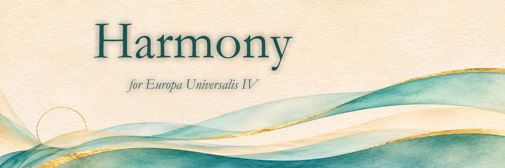

[](https://github.com/KisinTheFlame/eu4-harmony/actions/workflows/ci.yml)

English | [简体中文](README.zh-CN.md) | [日本語](README.ja.md) | [한국어](README.ko.md)

**Europa Universalis IV, made better from within.** Crisp Chinese, Japanese and Korean text everywhere, no restarts when returning to the main menu, faster late-game ticks, fewer engine bugs, and richer mods — with the game's rules left as they are.

> Jump to: [For Players](#for-players) · [For Mod Developers](#for-mod-developers) · [For Contributors](#for-contributors)

---

## For Players

### What changes compared to unmodified EU4

| | Unmodified game | With Harmony |
| --- | :-: | :-: |
| Crisp Chinese, Japanese and Korean text with system/bundled fonts and live font preview (no double-byte patch or bitmap font mod) | ✗ | ✓ |
| Return to the main menu in seconds without restarting the game | ✗ | ✓ |
| Load another save directly from an Ironman campaign | ✗ | ✓ |
| Smoother map panning and zooming even at speed 5, with less late-game stutter | ✗ | ✓ |
| Saving pauses the game roughly a third as long | ✗ | ✓ |
| Faster startup, loading, and late-game progression | ✗ | ✓ |
| Fixes duplicate heir names, reload memory leaks, and stale reformation-center crashes | ✗ | ✓ |
| Equalized music loudness and smooth, natural volume sliders | ✗ | ✓ |
| Optional relaxed achievement rules (outside Ironman or with mods) | ✗ | ✓ |
| Mods that add native-style UI panels and helper automation, with transparent permissions | ✗ | ✓ |
| **Game rules and vanilla balance unchanged** | ✓ | ✓ |

Your translation mod is still what translates the game; translation mods made for the old double-byte patch — and the saves played with them — work as they are. Harmony runs on **Steam Windows EU4 1.37.5**, single player only (multiplayer support is on the way).

### Installing

**Important: subscribing alone does not activate Harmony.** Copy one file (`version.dll`) into your game folder once:

1. Subscribe to **Harmony** on the Steam Workshop.
2. In Steam, right-click **Europa Universalis IV** → **Manage → Browse local files** to open the game folder (keep it open).
3. Open the Paradox launcher → **Mod library** → find **Harmony** → click **… → Show in folder**. (If Harmony does not appear yet, restart Steam, or open `steamapps\workshop\content\236850\<id>\` in the same Steam library as EU4.)
4. Copy `version.dll` from Harmony's folder into the game folder, next to `eu4.exe`. (Windows may hide file extensions, showing `version` and `eu4`. If an older `version.dll` already exists — e.g. from a double-byte patch — choose **Replace**, or back it up first if you want to switch back later.)

Start EU4 from the Paradox launcher as usual. Harmony needs no place in your playset; mods built on it are enabled in your playset like any mod. The main menu and in-game menu now show **Harmony v…**, **Mods** and **Settings** in the bottom-right corner.

Steam keeps Harmony up to date. When an update includes a newer `version.dll`, Harmony updates the copy in the game folder on startup and restarts the game automatically (only asking you to copy it manually if the game folder is read-only).

#### Manual install (GitHub Releases)

Download `eu4-harmony-<version>-windows-x64.zip` from [GitHub Releases](https://github.com/KisinTheFlame/eu4-harmony/releases), close the game, and extract it into the game folder beside `eu4.exe`. Because the local core takes precedence over the Workshop copy, Steam does not update manual installs; remove `eu4_harmony_core.dll`, `eu4_harmony_crash_dumps.dll`, and `fonts\` from the game folder's `eu4-harmony\` directory to switch back to Workshop updates. Players do not need the separate CLI archive (`eu4-harmony-cli-*.zip`).

#### Uninstalling

Unsubscribe from Harmony and delete `version.dll` from the game folder (restore any earlier backup if you kept one). If you enabled Windows crash dumps from **Harmony settings → About**, click **Disable Windows crash dumps for EU4 (admin)** there first.

### FAQ

- **I subscribed, why is Harmony not showing in the main menu?**
  Subscribing alone does not load Harmony. Make sure you copied `version.dll` next to `eu4.exe` (Step 4 above), and confirm your game is Steam Windows EU4 1.37.5.
- **My antivirus warned about `version.dll` or `eu4_harmony_core.dll`. Is it safe?**
  Harmony is open source under MIT and works by loading into `eu4.exe`, which can occasionally trigger heuristic false positives. You can review the code, add the EU4 game folder to your antivirus exclusion list, or build from source.
- **How do I migrate from the old double-byte CJK patch or bitmap font mods?**
  Replace the old `version.dll` with Harmony's, disable old bitmap font mods (no longer needed and they interfere with system fonts), and keep your translation mod enabled. Existing saves load directly.
- **Does Harmony support multiplayer?**
  Multiplayer support is on the way. Currently Harmony is single-player only and disables the main-menu Multiplayer button. To play multiplayer, unsubscribe from Harmony or temporarily move `version.dll` out of the game folder.
- **Are my saves compatible if I remove Harmony later?**
  Harmony itself does not break save files, except that custom names you type with Harmony are stored in UTF-8 and display as garbled text without it. If you use a Harmony mod that saves its own extension data into saves, those saves are not guaranteed to load without Harmony.
- **Why does the game sound quieter, or why did non-Ironman achievements not work on an existing save?**
  Harmony uses a smooth quadratic volume curve so slider steps feel even; values below 100 sound quieter until you adjust them once. Non-Ironman achievements must be enabled before starting a new campaign — existing saves without a tracked achievement list cannot retroactively reconstruct starting conditions ([details](docs/game/countries/achievements.md#each-achievements-script-conditions)).

### Troubleshooting

In the main menu or in-game menu, open **Harmony settings → About** and click **Save troubleshooting files to the desktop**. It creates a zip under 24 MiB (no saves) containing Harmony logs, game logs, recent crashes (oversized dumps are slimmed automatically), settings and playset. Click the GitHub Issues link right on the About page and attach that zip to your report.

Logs live in `Documents\Paradox Interactive\Europa Universalis IV\eu4-harmony\logs\`. See [docs/logs.md](docs/logs.md) for retention limits and crash-dump controls.

---

## For Mod Developers

### Writing a Harmony mod

A Harmony mod is an ordinary Paradox mod with an `eu4-harmony/` folder. Its Lua extension reads game state and issues player-equivalent orders through capabilities — never memory addresses:

```lua
-- eu4-harmony/lua/main.lua: a button declared in eu4-harmony/ui/ that shows
-- in the army panel while one of your armies is selected
return {
  on_frame = function(game)
    game.ui.button.visible = game.army.selected() ~= nil
  end,

  on_button = function(game)
    log("army " .. tostring(game.army.selected()) .. " clicked")
  end,
}
```

Download `eu4-harmony.exe` from [GitHub Releases](https://github.com/KisinTheFlame/eu4-harmony/releases):

```powershell
eu4-harmony new my-mod --name "My Mod"   # working starter mod with UI, localisation and editor types
cd my-mod
eu4-harmony check                         # validate all files as the framework will
eu4-harmony test                          # run eu4-harmony\tests\*.lua against a fake game
eu4-harmony link                          # register with the launcher, then enable in your playset
eu4-harmony reload --watch                # hot-reload the extension while the game runs
eu4-harmony types                         # regenerate LuaLS editor types after updating the CLI
eu4-harmony package                       # build a clean folder ready for Workshop upload
```

Sensitive permissions (`clock`, `files`, `network`) are declared in `manifest.toml` and displayed to players in **Harmony mods**.

Where to learn more:

- `eu4-harmony wiki`: complete capability reference, handlers and globals (`wiki lua`), manifest schema (`wiki manifest`), no game required.
- `eu4-harmony skills`: step-by-step guides (`skills mod`, `skills ui`, `skills testing`, …), readable by humans and coding agents alike.
- [cli/skills/mod.md](cli/skills/mod.md): extension lifecycle, error handling, time/memory limits and save data.

### Remote control & automation

A program or AI can drive the game as a player (or headless in the background) via `eu4-harmony game <capability> [<arguments>]`, returning JSON:

```powershell
eu4-harmony start --hidden                 # launch hidden; Steam must be running
eu4-harmony game menu start FRA            # start a new game as France
eu4-harmony game time advance 30           # advance 30 days (stops early for events)
eu4-harmony game question list             # inspect open events/questions
eu4-harmony game army move 545460846646 185
eu4-harmony game screenshot --out shot.png
eu4-harmony game menu return               # return to the main menu
```

In observe mode (`menu start` without a tag), use `session view FRA` / `session leave_view` to switch perspectives ([docs/game/countries/countries.md](docs/game/countries/countries.md)). Remote control listens only for the active Windows user on localhost; add `--as-game` for omniscient/script-level access ([ADR requests-act-as-the-player-or-as-the-game](docs/adr/2026-11-11-requests-act-as-the-player-or-as-the-game.md)). Run `eu4-harmony wiki remote` for details.

---

## For Contributors

### Documentation

Start at [docs/README.md](docs/README.md) for game internals, development tools, ADRs and research evidence. See [GLOSSARY.md](GLOSSARY.md) for project terminology and [docs/plans/README.md](docs/plans/README.md) for open work.

### Building from source

Requires Windows 10 (1903+) x64, [rustup](https://rustup.rs/) (reads [rust-toolchain.toml](rust-toolchain.toml)), and Visual Studio C++ Build Tools. An EU4 1.37.5 install is needed only to run the framework, offline checks, and test games.

```powershell
cargo build --release
cargo test
cargo xtask offline-check          # requires EU4 1.37.5 (Steam or EU4_GAME_DIR)
cargo xtask release --no-workshop  # pack GitHub release ZIPs without SteamCMD
```

To run isolated test games and scenarios locally (Steam running, EU4 1.37.5 with full DLCs):

```powershell
cargo xtask install                # once, with the game closed, so version.dll loads test cores
cargo xtask saves fetch            # once, to download and verify shared test saves
cargo xtask scenario sweep --owner <name>
```

See [docs/dev-tools.md](docs/dev-tools.md) for build, release, Workshop upload and isolated test-game workflows, and read [AGENTS.md](AGENTS.md) before opening a pull request. Changes reach `master` through pull requests.

### License

[MIT](LICENSE). Covers this repository's own code and documentation, not the game itself; mods remain subject to Paradox's modding terms.
