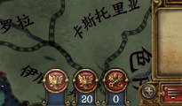
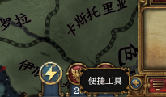

# 2026-11-12 Convenience Tools entry image and tooltip (tested by me)

The independent Convenience Tools entry was checked in an owned hidden test game after its visible hands-on game had already been handed to the user. The user's game was not controlled, restarted or updated. This records the earlier entry investigation; it does not validate the new shared text-description implementation or the entry-number work.

## Native evidence

A fresh process with the original static `CT_TITLE` declaration showed no entry tooltip. Assigning that same translated title dynamically did show it. A corrected static declaration path then showed the Chinese title without a per-frame assignment in the mod. The calibrated tooltip region had a contiguous dark-plate run of 17 pixels before and 59 afterward (the threshold was 40); the first region used by the probe had been too high and was discarded.

The mod's original entry used a vanilla HRE frame. It was replaced with an original blue enamel badge, a gold rim and a single gold lightning bolt, 41 by 40 pixels. The native button-state effect supplied hover and pressed appearance. The final capture contained no missing-resource placeholder pixels and showed the title “便捷工具”. Mouse down and release were captured separately; release opened the correct Convenience Tools window.

## Resource-loading diagnosis

The first custom-sprite attempt produced a missing-resource tile and `Could not find sprite type [GFX_convenience_tools_entry]` in the owned game's error log. Its `.gfx` and `.dds` files existed, but the absolute test-mod registration had not mounted them for native GUI loading. Adding the Harmony dependency or changing path slashes did not fix it. A standard relative descriptor registration in the claim's private `user/mod` directory loaded the same resources correctly. This is evidence for repairing the test-game registration tool; it is not a mounting technique required of mods.

The private registration was made only after removing the claim's junction itself while its game was stopped. No file was written through that junction into the player's mod directory. The claim's private fixtures were deleted, its original junction restored, and the claim released. The first release attempt refused the temporary regular directory; after restoration, release completed and reported the owned starts stopped with no crash. Scratch capture and registration scripts were removed. The visible hands-on claim remained with the user.

## Limits

This run checked the native image, static title, native button states and click action. It did not check an independent entry number, general disabled-element tooltips, framework-drawn controls or the new shared tooltip descriptions. No Steam item was created or uploaded.
