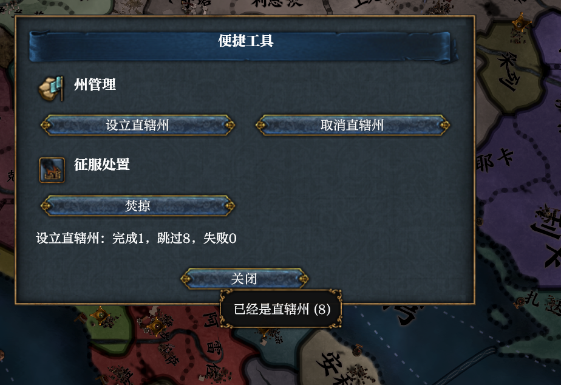

# 2026-11-12 Reviewed area and live capacity split (tested by me)

A focused follow-up to [the batch run](2026-11-12-convenience-tools.md) and [the grouped window](2026-11-12-convenience-ui.md), after reviewing the prediction failure boundary, text tooltips and national-capacity cost. The separate mod now scans only local areas and calls `country.governing_capacity` immediately before and after each eligible state command.

## Setup

EU4 1.37.5, baseline `daf21a47` plus the review corrections in Harmony's [capability pull request](https://github.com/KisinTheFlame/eu4-harmony/pull/183). Release build with `dev-test-games`, independently claimed owner `convenience-review-smoke`, hidden and silent, own user directory and pipe, with the matching Convenience Tools mod. A fresh Castile game at 1444.11.11; no player's save, settings or installed framework changed.

## Native comparison and mod wiring

The initial `country.governing_capacity` returned `used: 231500, max: 400000`. `province.area(206)` returned Galicia's four owned members and area costs, with no national-capacity fields. The native territory command prepared one eligible area in this disposable game. Afterward:

| State | Area cost | Live national used | Projected increment |
| --- | ---: | ---: | ---: |
| Galicia as territory | 7000 | 210500 | 7000 |
| After the mod's Make states button | 14000 | 217500 | 0 |

All table values are integer thousandths. The actual mod button reported `batch make_state: 1 succeeded, 8 skipped, 0 failed`, with `CT_ALREADY_STATE: 8`. Its single-line result and native text tooltip appeared. The final used total equals the pre-command live total plus the projected increment. The date remained 1444.11.11 and time remained paused.

## Regressions and scope

- A logically hidden text retains its tooltip but supplies none; showing it restores the tooltip. A tooltip-only update cannot reveal a hidden tooltip.
- Static list-row text and tooltip defaults use the window's localisation rather than an empty resolver.
- Negating the minimum signed static modifier and overflowing a core-transition sum both leave readable current cost intact, with an absent prediction and an overflow reason. The projection checks the first native factor/cost values read in the same area call, without calling those getters again.
- Area scans and abandonment do not read national capacity. The fixture checks exactly three eligible prechecks and two successful postchecks in its selection case. A failed required national read, before or after a command, stops subsequent states.
- All 22 named area dependencies are recorded and named in the address index, including the operand sites.

The complete Rust regression run passed 1011 tests with 6 ignored. Both ordinary and developer workspace clippy runs passed with warnings denied. All 13 separate-mod tests passed, including the original 12 and the capacity-read failure regression. No claim is made about a measured large-country speedup or new compatibility coverage beyond the previous runs.

The smoke claim was released; the tool reported its own stop with exit code 1 and no crash. A different claim was then prepared for the user's [hands-on trial](2026-11-12-convenience-hands-on.md). That trial receives no automated operations after handoff.
