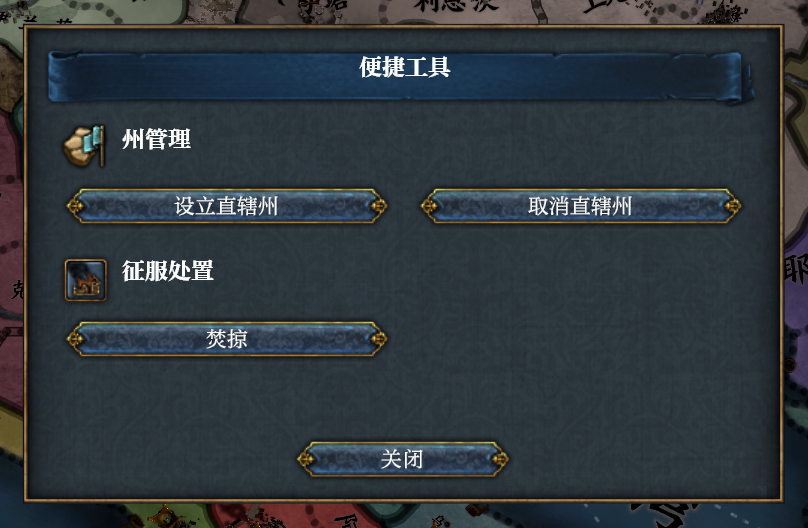
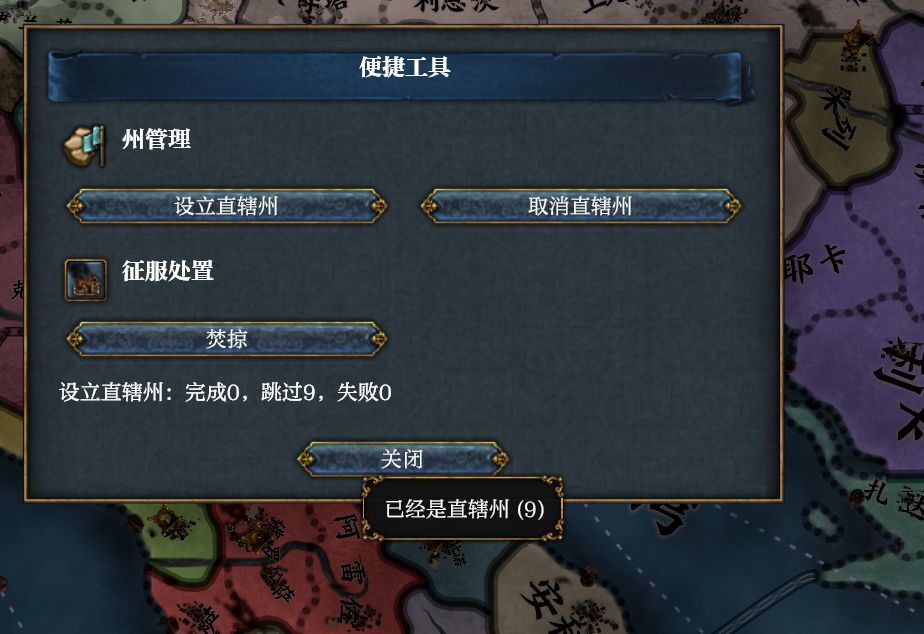

# 2026-11-12 Convenience Tools window and text tooltip (tested by me)

The separate Convenience Tools mod's grouped native window, following [the batch and capacity run](2026-11-12-convenience-tools.md). This run changes its presentation, not its batch rules. Harmony's only interface change allows an extension text box's existing tooltip property in the layout and Lua setter; it reuses `BoundElement` and the existing tooltip observer.

## Setup

- EU4 1.37.5, mainline baseline `daf21a47` plus the isolated worktree's uncommitted area capability and text-tooltip changes.
- Release build with `eu4-harmony-core/dev-test-games`, claim `convenience-ui`, started hidden and silent with `--mod D:/Workspace/eu4-convenience-tools/mod`.
- New 1444.11.11 game as Castile, inherited playset including Chinese localisation and Regional Combat. No player save, player settings, installed framework or original game files changed.
- Window 508 by 320 GUI units, game frame 3840 by 2160 with the inherited UI scale. Screenshots below are unscaled crops of that frame.

## Native interaction

The entry button opened the blue-and-gold native window. State management has Make states and Abandon states side by side, with the game's state icon; Conquest has a separate Raze button and the game's raze icon. The result line was empty before an operation. No preview, confirmation or extra control was added.

The Make states button reported `batch make_state: 0 succeeded, 9 skipped, 0 failed`, with `CT_ALREADY_STATE: 9`, since all nine areas were already states. The result named the operation and kept all three counts on one line. Hovering the actual result text showed the assigned reason and count in the game's gold-bordered tooltip. There is no overlaid button and no new native hook.

The native Close button dismissed the window. Reopening and pressing Esc dismissed it too. Reopening and dragging its title moved the complete window, preserving its result. The [separate checkpoints](images/2026-11-12-convenience-ui-interactions.png) show Close on the left, Esc in the middle and the dragged window on the right; this comparison uses 50% captures. The date stayed 1444.11.11 and `time.get` reported `paused: true`.

## Checks

The existing 12 mod tests pass, with their result assertions updated for the operation name and single line; they also check translated reason tooltips and clearing them on a new session. All four localisation files contain the same 22 keys and every layout key resolves. The seven relevant Lua property/layout tests, Lua clippy with warnings denied, formatting and release build passed.

## Language rendering and limits

The same claim was restarted with English, Japanese and Korean player-language settings, clearing only the claim's inherited body/heading font choices so each used its normal default. Chinese retained its custom inherited fonts. The mod title, both group headings, all three button labels, the 0/9/0 summary and the reason tooltip rendered completely without missing glyphs or clipping in all four languages:

| Language | Body and heading fonts | Evidence |
| --- | --- | --- |
| Simplified Chinese | Inherited FZPingXianYaSongS-R-GB / FZYaSongS-B-GB | [Result and tooltip](images/2026-11-12-convenience-ui-tooltip.png) |
| English | Segoe UI, regular body / semibold heading | [Window](images/2026-11-12-convenience-ui-english.png) |
| Japanese | Yu Gothic UI | [Window](images/2026-11-12-convenience-ui-japanese.png) |
| Korean | Malgun Gothic | [Window](images/2026-11-12-convenience-ui-korean.png) |

Each completed language run still reported 1444.11.11 and `paused: true`. The native Close label and the underlying game followed the inherited Chinese playset. Other UI scales, very large summary counts and arbitrarily long reasons were not exhaustively inspected. This run does not repeat the batch-mechanics cases from the earlier run, fill live governing capacity, or measure large-country performance.

An initial automated language screenshot caught the still-running batch. Capture was changed to wait for the actual completion log and for the native tooltip fade before taking the final evidence. Two setup-script errors were corrected in scratch code; each attempt stopped its own game in a `finally` block, without changing the product or the player's files.

## Cleanup

The claim was released. The tool reported all eight starts ended by its own stop/release path with exit code 1 and no crash; `game status` then reported zero held or running test games. Only the claim tool's seven-day kept logs, the repository evidence images and normal build caches remain. Raw full-screen captures and the two scratch input/capture scripts were removed. The previous batch-mechanics evidence remains unchanged. No installation, commit, push, pull request, merge or publication was performed.
