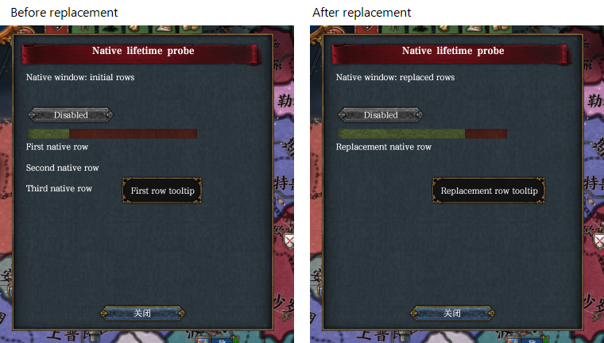
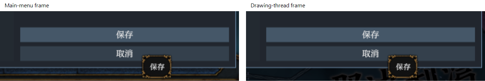

# 2026-11-13 Fourth deepening tooltip handoff (tested by me)

The two native processes of [fourth-deepening.md](../plans/fourth-deepening.md) were checked together in hidden claim `native-handoff-4510f0`, process 30512, from 04:28 to 04:42 on EU4 1.37.5. The core implementation is `450b5c34`, with master `e902f0a0` included; the probe has the corrected layout committed in `3ecdc4f2`. The release core had test-game pipes. The inherited Chinese playset, published Regional Combat and Convenience Tools, and private `qa-windows` were loaded. The frame was 3840 by 2160, the game UI scale 1.5, and captures were at 50%. No player files or installed framework were changed.

## Native observations

- At the main menu, the framework settings window was moved down until its bottom lay near the screen edge. The game's native Save tooltip drew above the framework Cancel button and the window border, entirely within the frame.
- In a paused French session, hovering the probe's text showed `Initial native tooltip` and its second line. Hovering the first list row showed `First row tooltip`. The pointer then stayed fixed while `popup.answer` advanced the probe to replace three rows with one: both the row and its tooltip changed to the replacement content, rather than retaining the old row's content.
- The settings window remained open while another French session started. The same lower-edge Save tooltip again covered the Cancel button and border, this time in frames from the drawing thread.
- Closing settings and returning to the main menu removed the extension window and old tooltip. A stable final main-menu frame was inspected; an earlier transitional loading frame was not treated as proof of cleanup.

The row comparison crops the upper-left native window from two captured frames. Only the crop and headings were added.

The tooltip comparison crops the lower controls of the main-menu and in-game captures, enlarged two times. Main-menu captures ran on thread 10424; the in-game capture at 04:38:28 ran on drawing thread 45696, matching the drawing-thread startup line. The screenshot encoder has other thread IDs; its pixel-copy messages do not establish the presenting thread. The older log wording “on the main thread” in the GPU-capture message is fixed text even on the drawing thread.

## Checks and limits

The claim's core log had no native late-tooltip error, window construction/list error, panic or fatal error. The [automated native courses](2026-11-13-fourth-deepening-native-windows.md) independently passed all 28 steps across reload and session changes. Before the native runs, the locked release build, all workspace tests (core: 780 passed and five offline-only tests ignored), both clippy configurations and both offline-check configurations passed. The five offline-only tests passed in each build.

These observations verify the selected native presentation paths and stationary row replacement. Native device loss, arbitrary side effects before a game function faults under SEH, every resource override and every destruction interleaving were not exhaustively tested. Failures at the framework's native-operation seam and caught Rust unwinds are covered by process tests; they are not claims of every real graphics or allocator failure being recovered.

## Cleanup

Release reported exit code `0x1`, no crash, and released `native-handoff-4510f0`, retaining its logs. The claim's user folder, private test mod, registrations, follower and core were removed. Two cropped evidence images remain here; fourteen intermediate captures were removed after the evidence was recorded. The whole scenario set runs in its own separately named claims.
