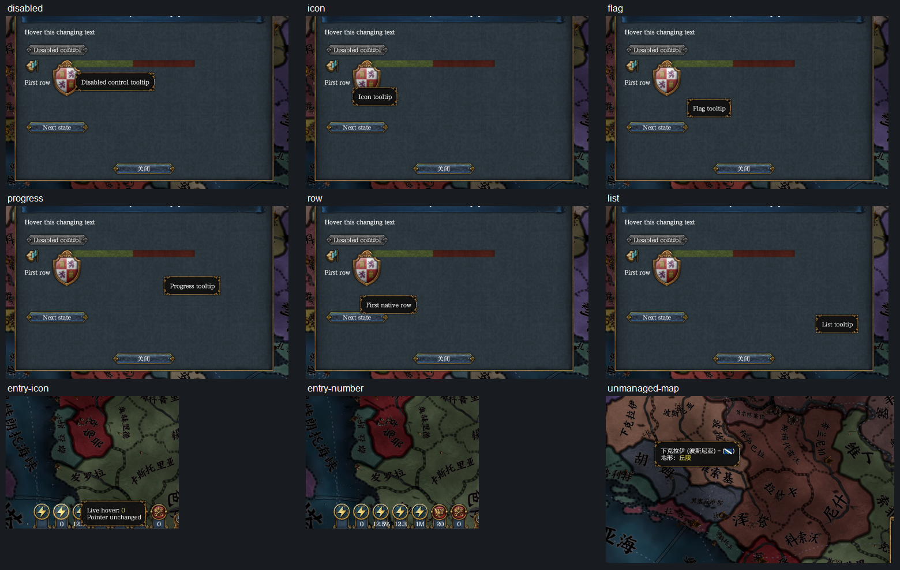
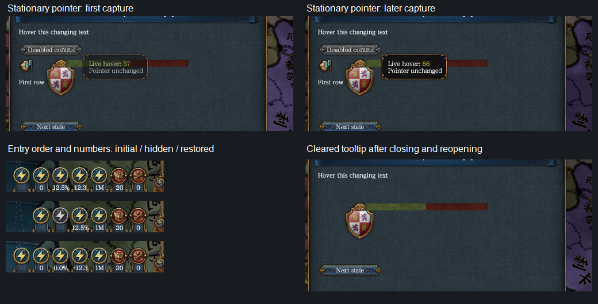
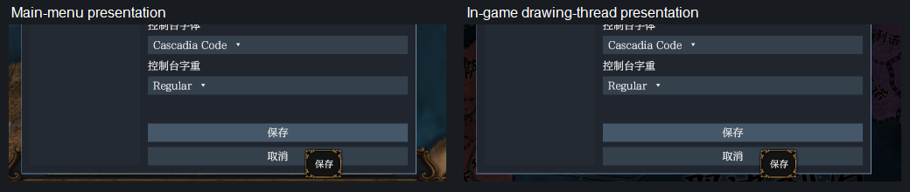
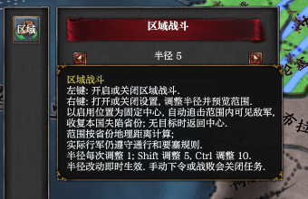

# 2026-11-13 Managed tooltips and panel entries (tested by me)

The shared tooltip adapters, direct entry images and independent numbers were checked on EU4 1.37.5 in the private hidden claim `panel-tooltip-final`, based on master `b7f07360` with the implementation in this change. This follows the [earlier static entry check](2026-11-12-convenience-entry.md); it does not repeat the country-wide batch runs. Native verification is complete for the cases below. The implementation was then rebased onto logging merge `564cf60a`; final integration checks passed without further product-source changes.

## Setup

The release core had `dev-test-games`. The private playset contained Native Entry Probe, current Convenience Tools source and a private copy of published Regional Combat 0.4.0 item 3837793510. The inherited local Regional Combat registration was removed from the claim's own `dlc_load.json` before starting, so the published extension was loaded. Startup reported all three private test-mod paths. The Workshop original and player files were not modified.

The inherited settings used Chinese, a GUI scale of 1.5 and unlimited drawing on its own thread. Captures were of a 3840 by 2160 frame, saved at 50%. The probe declared four direct DDS entries with integer zero, a decimal, a percentage and a compact large number, plus text, a disabled button, an icon, a flag, a progress bar and a rebuilt list row. Its frame handler changed tooltip text while stationary; a button cycled hidden/disabled state, absent/zero values and cleared tooltips. The game stayed paused.

## Failures found and corrected

- The first process reached the main menu with 2493 dependency points matching, then deliberately ended with framework fatal exit code 3 when the tooltip adapter read class address `0x1d933b0`. The draw-method slot was checked, but the class address itself was not. The correction checks the constructor operand at `0x155072c`; a regression requires the class and both draw-return addresses to be covered before runtime use.
- The first lower-edge self-drawn tooltip remained covered by the framework window. Three implementation errors were corrected: every content presentation unnecessarily changed its generation; the native vector was passed to a linked-list reader; and readiness required a non-null hit target. The tooltip-specific initializer deliberately clears that hit target at `0x1414de9`. Regressions now check stable generations, the actual vector storage and a ready node with no hit target. Object identity instead follows owner → holder → node, with the checked class, prepared texture, lifetime generation and current vector membership.
- An intermediate start was refused before creating a process because offline checks had rebuilt the release DLL without test-game pipes. Another retry accidentally used an old debug xtask executable, which appended obsolete absolute registrations and produced duplicate-mod notices. The loaded earlier entries still referenced the correct private copies. The extra registrations were removed from the private playset; subsequent starts used the current release xtask and had no duplicate registrations. Neither retry changed player registrations.

Temporary diagnostic logging was removed before the final native captures. A successful build or a state-only test was not treated as native presentation evidence.

## Native results

| Capability | Observed result |
| --- | --- |
| Direct image registration | All five original blue/gold entry images loaded from framework files, with no missing-resource tiles. Startup listed their private DDS paths. |
| Independent numbers | No value drew nothing; zero drew `0`; decimal `12.34` drew `12.3`; `0.125` drew `12.5%`; `1234567` drew `1M`. Later states showed `-12.3`, `0.0%` and the rounded `999999` boundary as `1M`. |
| Icon and number targets | The icon showed its own tooltip; the number beneath it did not inherit that tooltip. Clicking the number did not activate the entry or close its open window. |
| Hidden and disabled entries | Hiding the decimal entry closed its gap; restoring it recovered the original order. The disabled probe entry retained its tooltip; clicking it did not close the window. Clearing its number did not draw zero. |
| Managed native elements | Text, a disabled button, icon, flag, progress bar, list and list-row text each showed their own native tooltip. The list's empty space showed the list tooltip; the row text showed its own. |
| Stationary changes | Without another move request, the same text tooltip changed from `Live hover: 57` to `Live hover: 66`, retaining the second line `Pointer unchanged`. |
| Replacement and clearing | A rebuilt row showed `Rebuilt native row`; clearing the text tooltip left it empty after closing and reopening the window. Hidden controls disappeared and rows were removed. |
| Native passthrough | An unmanaged map province still showed its Chinese name and terrain. |
| Self-drawn presentation | The native Save tooltip remained wholly on screen at the bottom edge and visibly covered the framework Cancel button, both at the main menu and after entering a game. It was not painted beneath the framework window. |
| Published Regional Combat | Its finished tooltip string, assigned before panel binding, retained Chinese text, color and line breaks. Right click opened/closed the radius window; left click logged `army 846108557366 task on: center 219 radius 5`. Its native sprite reference still loaded. |

The final process's main thread was 82348 and its drawing thread 28356. Main-menu captures ran on 82348; in-game captures ran on 28356, matching the drawing thread's startup line and its 127–132 frames-per-second log. The screenshot log's fixed wording says “on the main thread” even for that drawing-thread capture; thread identity, not that wording, establishes which path ran. No late-scene error or further fatal error was logged in the final process.

## Automated checks and limits

After rebasing onto `564cf60a`, formatting, full workspace tests, both ordinary and developer clippy with warnings denied, and offline checks passed. The ordinary core suite had 755 passing tests and five intentionally ignored native checks; offline checking ran those five successfully in both configurations. Both `cargo build --release --locked` and the release build with `dev-test-games` passed. The final matching command line tool again passed all 13 Convenience Tools tests and all 50 Regional Combat source tests. The shared Host retained both tooltip access and logging maintenance/repeated-error methods. The source migration and generated template use explicit text descriptions. The four focused drawing tests also passed after the final correction.

This bounded run did not exhaustively test device loss, every idler switch or destruction interleaving, reload/unload while a tooltip is visible, language changes while hovering, every GUI scale, alternate ToolTip resource definitions, or TGA rendering. Path, dimensions, payload and state regressions cover rejected image declarations; they do not establish every native image-decoder case. The number click check establishes that it did not activate the entry, not every underlying map-click outcome. Fade was observed progressing from the first capture to steady display, without a pixel-level comparison of every intermediate alpha. No Steam item was created or uploaded.

## Cleanup

The previous user hands-on claim was read-only checked before cleanup. PID 71172 had already exited normally with code zero. Its release reported no crash and kept its logs. No input, restart or core replacement was sent to that user's game.

`game release --owner panel-tooltip-final` kept this run's logs and reported the first framework fatal exit 3 as a crash; the six subsequent processes ended through stop/release with exit 1. The last process had no further fatal error. The final status was zero held test games and zero running test games. A separate unclaimed game process 59364 was reported and left untouched. The claim's private content and registrations were removed by release. Necessary screenshots remain here; 104 temporary fixtures, captures, scripts and diagnostic outputs were removed after integration. The old empty Convenience Tools `interface` directory was removed after its obsolete sprite declaration had been replaced by the direct image. Original image sources, the read-only published item, retained test logs and normal Cargo build caches were kept.
