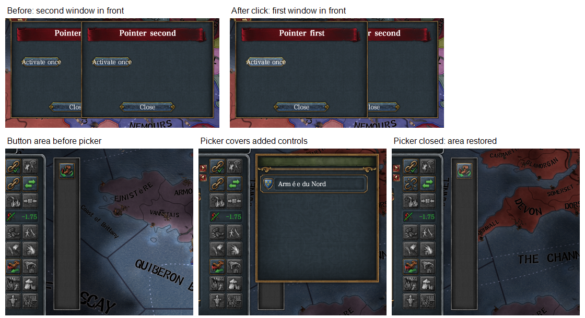

# 2026-11-14 Pointer activation and army attach picker acceptance

This run checks the two remaining critical pointer cases of the [ordering plan](../plans/window-ordering.md), using PR 194 commit `b8cced2d` without native-code changes. The branch already contained the latest `origin/master`. Release build with `dev-test-games`, default threaded drawing, no diagnostic probes or `dev.toml`. The user authorized coordinate input only in this isolated hidden test game. No further game cases were run after these passed.

Claim `ordering-acceptance-1de2b155`, created 17:12:17, hidden process 102884, main thread 91060. The claim's own playset was cleared before startup, then only `qa-window-ordering-pointer` was enabled; player files were untouched. A fresh France session was paused on 1444.11.11. `flavor_fra.206` was answered, the separate startup screen dismissed with Escape, and the fixture reloaded. The fixture passed `eu4-harmony check` before startup.

## Pointer activation preserves the action

The fixture opens `first`, then overlapping `second`, both non-panel windows. Clicking the exposed `first.activate` button at `(133,183)` in the 50% screenshot logged `first action once` at 17:14:51.044. The screenshot shows `first` in front afterward. One Escape then closed `first`, with `second` still open; its callback asserted that the click ran exactly once and the later-opened window did not close first. It logged `qa-ordering-pointer passed` at 17:14:57.626, then closed `second`. The other window's button callback would fail if the activation were replayed into it. No assertion failed.

## Picker covers the button area, takes input, then restores access

`army.split` split army `545460846646` in Paris, returning `5205500362806`. `army.options` confirmed the first army could attach to that target. Outliner clicks selected armies through the original interface; `army.selected` confirmed `545460846646` before the picker check. The framework logged a successful one-element ArmyPanel binding.

1. Clicking the added button at `(417,272)` logged `host action 1` at 17:15:50.884.
2. The original `h` shortcut opened the attach picker. Its background and target row visibly covered the added button and the overlapping part of its frame.
3. Clicking the same `(417,272)` while covered produced no additional host action and no attachment. Thus the covered control did not receive the click.
4. Clicking the target row at `(420,285)`, also in the overlapping area, closed the picker. A subsequent `army.get` returned `blocked = ["attached"]`, confirming that the original row action actually ran. The immediate request before the next completed frame still showed the old state; the screenshot and subsequent read supplied the completion evidence.
5. The added button reappeared at the same position. Clicking `(417,272)` again logged `host action 2` at 17:16:56.888. No host callback occurred between actions 1 and 2.

## Result and cleanup

Both targeted regressions passed. No native ordering error, panic, binding refusal or exception appeared in the framework log. Released at 17:17:25, exit code 1, no crash; no claim from this session remained. Logs are retained under `C:\Users\kisin\AppData\Local\eu4-harmony-dev\claims\ordering-acceptance-1de2b155-20261114-171217\kept`. Full-frame temporary screenshots were removed after cropped evidence was preserved. No installation or player-process operation occurred.

The native Rust source is unchanged from the already checked PR commit; only the acceptance fixture, evidence and documentation were added. The earlier build, workspace tests, both Clippy configurations and offline checks were not repeated. This run does not establish multiple events within one native batch, live scrollbar movement, or an exhaustive original-window inventory. Those cases were not added to this bounded regression run.
