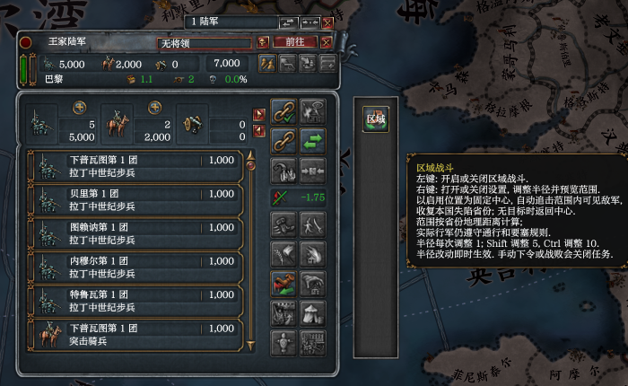
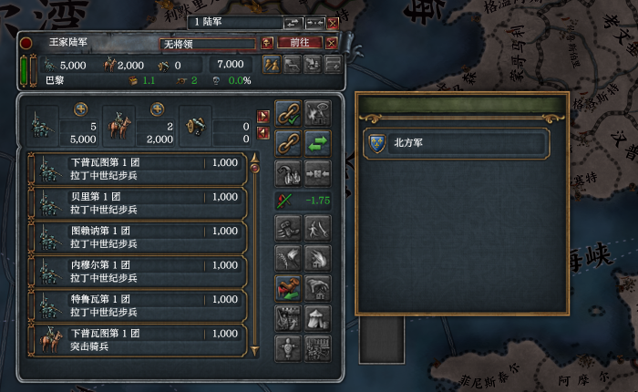
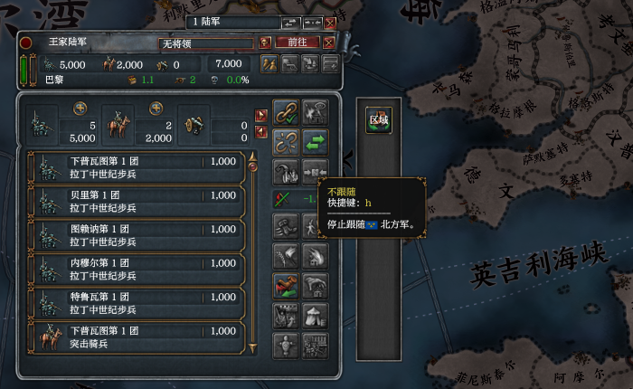

# 2026-11-15 Army attach picker with the actual playset

This run accepts the derived-icon correction against the same actual playset that exposed the unresolved overlap in the [user's earlier game](2026-11-14-window-ordering-user-game.md). Unlike the [isolated fixture](2026-11-15-window-ordering-icon-fixture.md), it used the copied enabled Workshop descriptors unchanged, including Regional Combat and Convenience Tools.

## Setup

- Source: correction `1077dbd6`, with current `origin/master` merged at `4c771fd9` before the run; release core built with `eu4-harmony-core/dev-test-games`.
- Owner: `ordering-icon-actual-1de2b155`; claim folder `C:\Users\kisin\AppData\Local\eu4-harmony-dev\claims\ordering-icon-actual-1de2b155-20261115-032027`; process 104808.
- The copied playset retained all eight enabled Workshop descriptors: `253263609`, `2830362508`, `2976470733`, `1999055990`, `3253723536`, `3837775887`, `3837793510`, `3838535796`. It was not cleared or supplemented with a test mod. No player or Workshop file was modified.
- The user authorized CLI coordinate input for this isolated run. It stayed hidden and silent.
- `game start` completed main-menu readiness before `menu.start --country FRA`. France remained paused on 1444.11.11. The opening event was answered through `question.answer`, and Escape dismissed the separate startup screen.
- `army.split --army 545460846646` created target army `5205500362806` in Paris. A click in the original outliner selected the original army.

## Course and result

Coordinates below are in the 1920 x 1080 screenshot, passed with `--scale 50` against a 3840 x 2160 frame.

1. Core log at `03:38:09.873`: `ui: bound 2 element(s) in ArmyPanel 0x1d1cc1d04d0`. Both the actual toggle and glow were bound. No unknown visual-group error or ordering panic appeared.
2. Clicking the actual Region button at `(419,272)` enabled the task. Regional Combat logged `03:39:15.773 army 545460846646 task on: center 183 radius 5`. The glow and the task's map overlay were visible.
3. H opened the original attach picker. Its background completely covered the Region button and glow and the overlapping part of the button-area frame.
4. Clicking `(419,272)` while covered produced no task toggle. The log still contained only the original `task on`, with no `task off (toggle)`; the task's map overlay remained visible.
5. Clicking the target name at `(500,296)`, within the area overlapping the button strip, executed the native action and closed the picker. Hovering the native attach button at `(317,297)` showed the Chinese text `停止跟随北方军`, confirming that the army now followed the chosen target. This did not call `army.attach` directly. `army.get` does not expose attachment, so the native Detach tooltip supplied the state evidence.
6. Clicking the restored Region button at `(419,272)` logged exactly `03:41:44.149 army 545460846646 task off (toggle)`. The map overlay disappeared. Thus the covered click did not reach the mod, and the same position worked again after the native picker closed.

The images are unaltered rectangular crops, starting at `(0,140)`, of the 50% screenshots. Chinese in these images and the quoted tooltip is in-game text from the actual playset.

## Cleanup and limits

`game release` succeeded at 03:42:10, reported process exit `0x1` as an intentional stop, and explicitly reported no crash. Logs were kept under the claim's `kept` folder. `game status` subsequently listed neither owner from this effort; other sessions' games were left alone.

This actual-playset acceptance passed: the original overlap no longer reproduced, the covered mod button received no click, the native target row executed, and the mod button worked after closing. This is one paused France session with the unchanged actual playset, not acceptance of every native window. Multiple events within one native input batch and movement of a live text scrollbar remain unverified.
