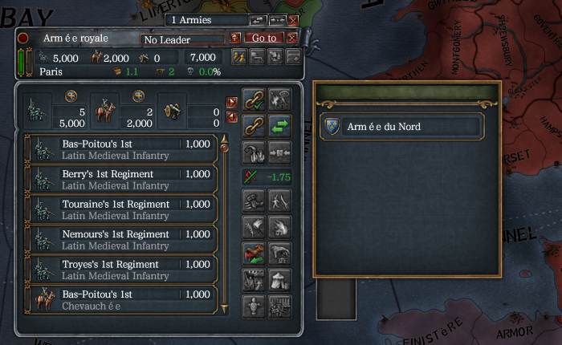
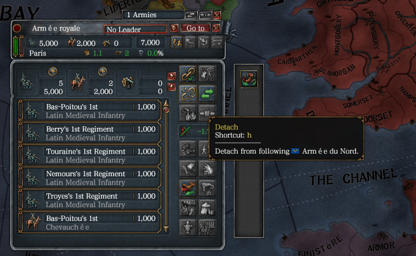

# 2026-11-15 Attached button and glow icon ordering

This run accepts the derived-icon correction in the private window-ordering adapter. The earlier button-only fixture missed the class rejection described in [window-placement.md](../research/window-placement.md#game-icons-have-a-derived-class). The fixture now declares a button and a glow icon together. This was a bounded regression of that binding and the army attach picker, not a repetition of the complete window-ordering course.

## Setup

- Source: correction `1077dbd6`, with current `origin/master` merged at `4c771fd9` before the run; release core built with `eu4-harmony-core/dev-test-games`.
- Owner: `ordering-icon-fixture-1de2b155`; claim folder `C:\Users\kisin\AppData\Local\eu4-harmony-dev\claims\ordering-icon-fixture-1de2b155-20261115-031816`; process 12616.
- Only the claim's copied playset was cleared, then `qa-window-ordering-pointer` was added with `game start --mod`. The fixture passed `eu4-harmony check`. No player or Workshop file was modified.
- The user authorized CLI coordinate input in this run and the separate actual-playset acceptance run. Both stayed hidden and silent.
- `game start` returned successfully at the main menu before `menu.start --country FRA`. France remained paused on 1444.11.11. `question.answer --question 2 --option 0` dismissed the opening event; three Escapes dismissed the separate startup screen and the fixture's two extension windows.
- `army.split --army 545460846646` created target army `5205500362806` in Paris. A click in the original outliner selected the original army.

## Course and result

Coordinates below are in the 1920 x 1080 screenshot, passed with `--scale 50` against a 3840 x 2160 frame.

1. The host bound both elements successfully. Core log: `03:36:12.577 ui: bound 2 element(s) in ArmyPanel 0x25561e7d070`. There was no unknown visual-group error or ordering panic.
2. Clicking the probe at `(419,272)` produced exactly `03:37:30.907 qa-ordering-pointer host action 1`.
3. `input.key --keys h` opened the native picker. Its background covered the probe and glow, and the overlapping portion of the button-area frame. Clicking `(419,272)` again left the callback count at one.
4. An initial click at `(420,296)` hit the target row's country shield and opened diplomacy. This was not counted as a successful attach. After Escape and reselecting the army in the outliner, H reopened the picker. Clicking the target **name** at `(500,296)` closed the picker and changed the native attach button to Detach.
5. Hovering `(317,297)` showed `Detach following Armee du Nord` (the in-game name contains accented letters), establishing that the original target-row action executed. `army.get` was also read, but it does not return an attachment field; it was not used as proof of attachment.
6. Clicking the restored probe at `(419,272)` produced exactly `03:40:46.326 qa-ordering-pointer host action 2`. Thus the covered click produced no callback, while the same position worked before opening and after closing the picker.

The images are unaltered rectangular crops, starting at `(0,140)`, of the 50% screenshots.

## Cleanup and limits

`game release` succeeded at 03:41:45, reported process exit `0x1` as an intentional stop, and explicitly reported no crash. The claim's logs were kept under `kept`; `game status` subsequently listed neither owner from this effort.

This regression passed. It establishes complete icon/button host binding, picker coverage, covered-button input exclusion, the native target action and closing restoration. It does not add coverage for multiple events within one native input batch or movement of a live text scrollbar. The separate [actual-playset run](2026-11-15-window-ordering-actual-playset.md) supplies the original mod combination's acceptance.
