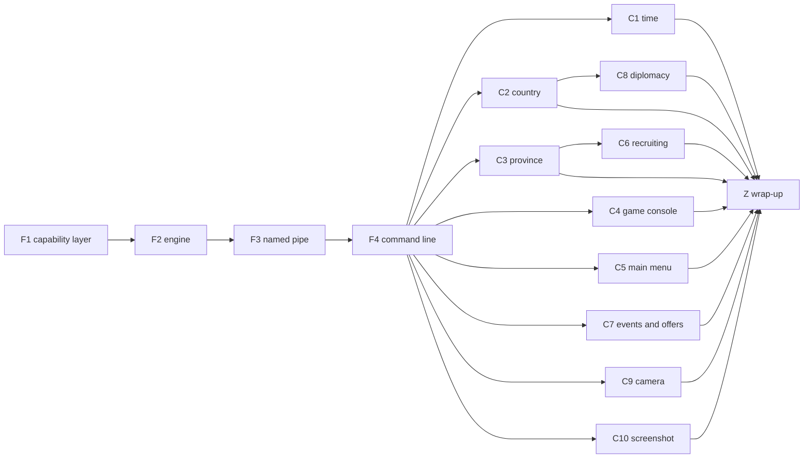

# Remote control plan

Status: final (2026-10-29). Terms are in [GLOSSARY.md](../GLOSSARY.md). The decisions and their reasons are in [ADR 0015](adr/0015-remote-control-uses-capabilities.md) (built in, capabilities only, acting as the player), [ADR 0016](adr/0016-remote-control-engine-and-transports.md) (engine and transports) and [ADR 0017](adr/0017-remote-control-is-always-on.md) (always on).

## Goal and scope

- **Goal**: programs outside the game process use the game through the framework's capabilities. Two uses drive it: debugging the framework from the command line, and an AI playing a whole game through `eu4-harmony game`, from the main menu on.
- **In scope**: the capability layer shared by extensions and remote control; the remote control engine; the named pipe transport; the command line client; time control; country and province snapshots; the game console; the main menu; recruiting; answering events and offers; diplomacy; the camera; screenshots.
- **Out of scope**: map coloring by remote clients; a setting or a mark on screen for remote control; any way to read memory or call game functions from outside; multiplayer; transports other than the named pipe.

## How it fits together

```
 remote client ── transport (named pipe, JSON lines) ── engine ──┐
                                                                 ├── capability layer ── game
 extension ── C ABI (GameApi, host functions in ext.rs) ─────────┘
```

- **Capability layer** (`core/src/game/`, one file per group): each capability is a function taking a `Caller` (`Extension(index)` or `Remote`) and returning the framework's own Rust types, not `abi::*`. It holds all the logic: looking objects up, checking state, calling the game. With `Caller::Remote`, an order is the player's: it takes the army back from the extension that owned it and raises "the player gave an army an order".
- **Engine** (`core/src/remote/`): requests are nested enums, one variant per group (`Request::Country(CountryRequest)`), each group in its own file. Requests from transport threads are queued and run at a safe point on the main thread, every frame, in the main menu as well as in a game, within a time budget per frame. A request that waits (advancing time) gets its response at a later safe point. The engine keeps a bounded buffer of numbered events (the same events extensions hear) and writes every request to the framework log.
- **Shared crate** (`remote/`, like `loc/` and `manifest/`): the request and response types, their serde form and a description of every capability and argument, used by the core and the command line tool.
- **Transport** (named pipe, see ADR 0016): many clients at once, each request handled in order of arrival; it encodes and decodes, and never touches game state.
- **Command line client** (`cli/`): `eu4-harmony game <capability> --<argument> <value>`, `eu4-harmony game describe`, `eu4-harmony game events --since <n>`; JSON on standard output, a non-zero exit code on an error; `--out <file>` writes a binary result to a file and prints its path.

### Identifiers in JSON

A country is its tag (`"FRA"`), a province its number, an army its ID as a decimal string. Dates are `"1444.11.11"`.

### Which side sees which capability

| Capability | Extensions | Remote control |
| --- | --- | --- |
| Session, countries, provinces, neighbors, armies, routes, pathfinding, move and stop, selected army | yes | yes |
| Time control: pause, resume, speed | yes | yes |
| Advance time and wait for it, with the events on the way | no | yes |
| Events | callbacks | read from the buffer |
| Country snapshot, province snapshot | yes | yes |
| Game console | yes | yes |
| Main menu: list saves, load a save, start a game, return to the main menu | no | yes |
| Recruiting, diplomacy, answering events and offers, camera | yes | yes |
| Screenshot | no | yes |
| Interface elements, extension save data, the mod's texts, logging | yes | no |
| Map coloring | yes | no |

An extension-side capability is added to the ABI by appending (ADR 0014): a `GameApi` field, the host function, the SDK method and `FakeGame` support.

### Granularity

A command is one action per capability (choose an event option, accept an offer, declare war). A read fetches one object's snapshot in one go. The exact list of capabilities in each group is decided by the node that builds it, once its reverse engineering is done, and written into its section below.

## Nodes



F1 to F4 run one after another: they set the shape of the files every later node adds to, and F4 gives the later nodes the command line to try their capabilities in the game. The C nodes run in parallel. How nodes are developed and merged is in [AGENTS.md](../AGENTS.md#parallel-development).

### Every node is done when

1. It is rebased on the latest requirement branch, conflicts resolved.
2. `cargo build --release` and `cargo test --release` pass.
3. The offline checks (`cargo test --release -p eu4-harmony-core -- --ignored`, with the game) pass.
4. What it adds was tried in the running game, and [prototype-log.md](prototype-log.md) has a dated section for the run, saying as plainly what was not verified.
5. New findings about the game are in [research/](research/), with addresses as RVAs into the 1.37.5 baseline, and every new place in the game is a dependency point.
6. Its section below lists the capabilities it added, with their arguments and results.

### F1 Capability layer

Move the logic of every capability out of the host functions in `core/src/ext.rs` into the capability layer, one file per group, taking a `Caller` and returning the framework's own types. The host functions only convert to and from the ABI. Implement the `Caller::Remote` order semantics (the player's order: ownership taken back, the event raised once) even though nothing calls it yet, with a unit test.

Done when: the game behaves exactly as before, through extensions; the existing in-game checks pass.

Built (2026-10-29). F1 added no capability; it moved every existing one into the layer, where each takes a `Caller` first and fails with a `game::Status` (`NotInGame`, `NotReady`, `NotFound`, `Rejected`, `InvalidArgument`, `Unavailable`, `WrongContext`, `Internal`) and a message. A country is a `game::Tag`, a province its number, an army its 64-bit ID. The capabilities the table gives extensions only refuse `Caller::Remote` with `Unavailable`. What the layer has for F2 to wire:

| Group (file) | Capability | Arguments | Result |
| --- | --- | --- | --- |
| `session` | `session` | | `Session`: session number, date (a day number), paused, visibility current, player |
| `countries` | `tag` | country | its three letters |
| | `hostile` | two countries | at war, or either is rebels |
| `provinces` | `provinces` | | every `Province` by number: land, lake, impassable, visible, owner and controller if any |
| | `neighbors` | province | `Neighbor`s: province, across a strait |
| `armies` | `army` | own army | `Army`: owner, province, land, the states that stop orders (in battle, sieging, retreating, exiled, movement locked, attached, has followers, busy), regiments, route length, destination, `RouteSource` (none, external, own, other extension) as the caller sees it |
| | `own_armies` | | the player's `Army`s and fleets |
| | `in_province` | province | visible land `Army`s there; `NotReady` while visibility is not current |
| | `route` | own land army | the provinces on its route |
| | `can_enter` | own land army, province | whether it may enter |
| | `strait_open` | own land army, two provinces | whether the strait between them is open to it |
| | `can_attack` | own land army, target army, province | whether it may attack the target there |
| | `find_route` | own land army, goal | the route the game would choose; `NotFound` when none |
| | `move_to` | own land army, goal | done once the route is installed; `Rejected` with the reason |
| | `stop` | own land army | done once it has no route |
| | `selected` | | the own land army in the open army panel |
| `interface` (extensions only) | `set_visible`, `set_enabled` | element name, on or off | |
| | `set_text`, `set_tooltip` | element name, text | |
| `map_coloring` (extensions only) | `paint` | `MapColor`s (province, RGBA) | |
| | `clear` | | |
| `save_data` (extensions only) | `get` | | the caller's JSON value, if any |
| | `set` | JSON value, or none to remove it | |
| `texts` | `language` | | the player language's Paradox name |
| | `text` (extensions only) | key | the mod's text in the player language |

`move_to` and `stop` from `Caller::Remote` are the player's orders: the army's route is nobody's afterwards, and `Change::Ordered` is raised once, so extensions hear `on_army_ordered` at the next safe frame (unit test `a_remote_order_is_the_players`). `game::begin_frame` starts a safe frame and forgets the old session's map, routes and map coloring; the extension dispatch in `ext.rs` runs on it, and so can the engine.

### F2 Engine

The `remote/` crate with the request and response types and their descriptions; `core/src/remote/` with the queue, the safe point in the main menu and in a game, the time budget, requests that answer later, the event buffer, logging. Wire up every capability that exists and that remote control sees (see the table). The engine is driven by typed requests in its tests.

Done when: unit tests drive the engine through every existing capability with typed requests; in the game, requests submitted from another thread are answered at safe points in the main menu and during a game.

Built (2026-10-29). The shared crate is `remote/` (`eu4_harmony_remote`), one file per group; each capability is declared once there, and its request, its answer and its description come from that declaration (`capabilities()` lists them all). In JSON a request is one flat object, `{"capability": "army.move", "army": "4294967377", "goal": 151}`: the group, a dot and the capability's own name (`army.move`, `country.hostile`), or the group alone when the capability's own name is empty (`session`, `events`, `describe`). The engine is `core/src/remote/`, one file per group, each with its slice of the capability layer as a trait, so that the tests put a fake game behind it. How it runs:

- **Safe points** (`core/src/safe_point.rs`, [research/safe-points.md](research/safe-points.md)): a game's safe frame, after extensions, where every request runs; and every frame the main thread presents when remote control did not run at a game frame since the last. There, what needs no game runs, and what needs one is answered `not_in_game` in the main menu (any of its pages, the single player setup included) and waits for a game frame elsewhere (a game being set up, a frame that is not ready). While a save loads, nothing runs.
- **Budget**: queued requests run in order of arrival until 5 ms have gone, at least one a frame; the rest run at the next frame, in order.
- **Answering later**: running a request may come to an answer at a later safe point (`Outcome::Later`, a `Wait` asked at each safe point, with the game at a game frame). The first such request is `events` with `wait_ms`; C1's advancing time is the next.
- **Giving up**: a transport waits on the `Reply` that `submit` returns; dropping it gives the request up, and one that has not run yet never runs, so a client that timed out does not move an army later.
- **Events**: what extensions hear at a game's safe frame, in the same order (a new session, the changes, a new day), numbered from 1; the latest 10,000 are kept. A `since` beyond the last event (from before the game started again) reads every event kept, with `missed`, since the events that followed it then are gone; `missed` is set too when events after `since` were dropped before they were read.
- **Log**: every request in the framework log, as JSON, with how it ended and how long it took; one that waits, again when it answers.
- **Countries**: a request names a country by its tag, and the engine finds the country through a new capability in the layer, `countries::find` (the country manager's array, two new dependency points, [research/countries.md](research/countries.md)). The layer's `tag` has no remote counterpart, since a remote client already names countries by their tags.
- **Trying it without a transport**: with `EU4HARMONY_TEST_REMOTE` set when `eu4.exe` starts, a thread of its own submits requests every 5 s and logs the answers (`core/src/remote/probe.rs`); set to `orders`, it also moves one of the player's armies one province and stops it, once a session.

| Capability | Arguments | Result | Needs a game |
| --- | --- | --- | --- |
| `session` | | `session`, `date`, `paused`, `visibility_current`, `player` | yes |
| `country.hostile` | `country`, `other` | whether they are at war, or either is a rebel faction | yes |
| `province.list` | | every province: `id`, `land`, `lake`, `impassable`, `visible`, `owner`, `controller` | yes |
| `province.neighbors` | `province` | `province`, `strait` for each neighbor over land | yes |
| `army.get` | `army` (the player's) | an army: `id`, `owner`, `province` (null for a fleet), `land`, `in_battle`, `sieging`, `retreating`, `exiled`, `movement_locked`, `attached`, `has_followers`, `busy`, `regiments`, `route_len`, `destination`, `route_source` (`none`, `external`, `extension`) | yes |
| `army.list` | | the player's armies and fleets | yes |
| `army.in_province` | `province` | the land armies the player sees there; `not_ready` while visibility is not current | yes |
| `army.route` | `army` | the provinces still to go | yes |
| `army.can_enter` | `army`, `province` | whether it may enter | yes |
| `army.strait_open` | `army`, `from`, `to` | whether the strait is open to it | yes |
| `army.can_attack` | `army`, `target`, `province` | whether it may attack the target there | yes |
| `army.find_route` | `army`, `goal` | the route the game would choose | yes |
| `army.move` | `army`, `goal` | null once the route is set; the player's order | yes |
| `army.stop` | `army` | null once it has no route; the player's order | yes |
| `army.selected` | | the army in the open army panel; `not_found` when there is none | yes |
| `text.language` | | the player language's Paradox name | no |
| `events` | `since`, `wait_ms` (both optional; at most 60000) | `events` (each with its `number` and `event`: `session` with `session`, `day` with `date`, `army_ordered` or `army_defeated` with `army`), `last`, `missed` | no |
| `describe` | | every capability: `capability`, `about`, `in_game`, `args` (`name`, `kind`, `optional`, `about`), `result` | no |

An error's `code` is `not_in_game`, `not_ready`, `not_found`, `rejected`, `invalid_argument`, `unavailable`, `internal`, or, for a transport that cannot read a request, `bad_request` (`request_from_json`; `response_json` writes a response as F3 sends it).

Found in the game: returning to the main menu starts `eu4.exe` again. A remote client loses the pipe until the new process opens it, and event numbers start again from 1.

### F3 Named pipe

The transport of ADR 0016: the pipe open to the current user only, several clients at once, JSON lines in and out, errors as `{"ok": false, "error": {"code": ..., "message": ...}}`.

Done when: a test client talks to the transport in a unit test; in the game, a client on the pipe reads the session.

### F4 Command line

`eu4-harmony game ...` as described above, built from the descriptions in the shared crate, with a timeout option.

Done when: in the game, the command line reads the session, lists the player's armies, moves one and stops it; `describe` lists every capability.

### C1 Time

Pause, resume, read and set the speed, read the date. `time advance <days> [--speed <s>]`, remote control only: resume, pause when the date is reached, answer with the events on the way; answer early, with the reason and the date, when the player pauses, a game event needs an answer, the game returns to the main menu or the session changes.

Done when: in the game, advancing 30 days stops on the right date with the day events in the answer, and an early stop says why.

### C2 Country snapshot

One read of a country: treasury, manpower and its maximum, stability, prestige, the three kinds of monarch points, wars (each with its attackers and defenders) and diplomatic relations (allies, subjects, overlord, rivals, at least). C8 relies on the wars and relations.

Done when: in the game, the player's country and another country read correctly against what the game shows.

### C3 Province snapshot

One read of a province: its name (as game text, see GLOSSARY), development (tax, production, manpower), terrain, fort, buildings, and what can be recruited there. C6 relies on the last.

Done when: in the game, several provinces read correctly against what the game shows, a Chinese name included.

### C4 Game console

Run a command in the game console and return what it printed.

Done when: in the game, `add_treasury 100` raises the treasury, and a command's output comes back.

### C5 Main menu

Remote control only: list the saves, load a save, start a game as a country (at the default start date at least), return to the main menu. Back up saves first, as AGENTS.md says. Returning to the main menu starts `eu4.exe` again (F2, [research/safe-points.md](research/safe-points.md)), so its answer cannot come from the process that was asked.

Done when: in the game, a remote client gets from the main menu into a loaded save and into a new game, and back out.

### C6 Recruiting

Recruit a regiment of a given kind in a given province.

Done when: in the game, a regiment is queued for recruiting, and a refusal says why.

### C7 Events and offers

List the game events waiting for the player's answer, with their options; choose an option. List the diplomatic offers waiting for an answer; accept or decline one. C1's early stop on "a game event needs an answer" comes from here if C1 cannot see it on its own.

Done when: in the game, an event (raised with the game console if need be) is listed and answered, and an offer is accepted or declined.

### C8 Diplomacy

The player's diplomatic actions, one per capability: at least declaring war, offering peace (white peace at least) and proposing an alliance.

Done when: in the game, each action takes effect, and a refusal says why.

### C9 Camera

Read where the camera looks and its zoom; look at a province; look at a map position; set the zoom.

Done when: in the game, each moves the view as asked.

### C10 Screenshot

Remote control only: the frame as the player sees it, framework UI included, read back from the D3D9 device after the framework UI is drawn (`core/src/framework_ui/d3d9.rs`), as PNG; `--scale` shrinks it.

Done when: in the game, a screenshot taken through the command line matches the screen, in the main menu and in a game.

### Z Wrap-up

Play through the command line only, as an AI would: from the main menu into a game, observe, advance time, answer events and offers, move armies, recruit, use diplomacy, take screenshots, return to the main menu. Fix what that turns up. Document remote control in README.md and README.zh-CN.md, check that the player's installation contains `eu4-harmony.exe`, and record the play-through in prototype-log.md.

Done when: the play-through works start to end and README.md, README.zh-CN.md and prototype-log.md say how and what was seen.
