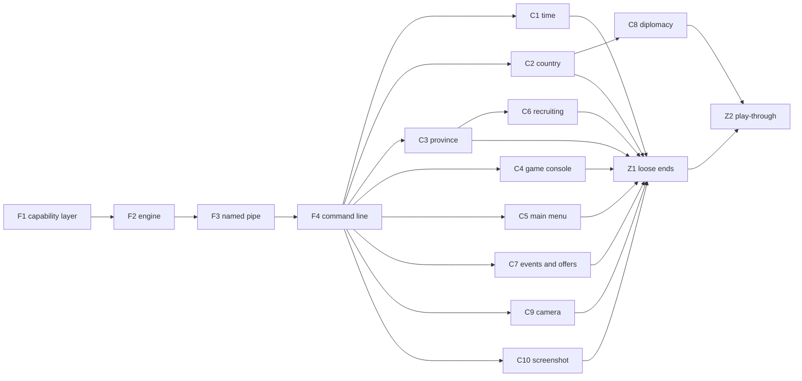

# Remote control plan

Status: final (2026-10-29). Terms are in [GLOSSARY.md](../GLOSSARY.md). The decisions and their reasons are in [ADR 0015](adr/0015-remote-control-uses-capabilities.md) (built in, capabilities only, acting as the player), [ADR 0016](adr/0016-remote-control-engine-and-transports.md) (engine and transports) and [ADR 0017](adr/0017-remote-control-is-always-on.md) (always on).

## Goal and scope

- **Goal**: programs outside the game process use the game through the framework's capabilities. Two uses drive it: debugging the framework from the command line, and an AI playing a whole game through `eu4-harmony game`, from the main menu on.
- **In scope**: the capability layer shared by extensions and remote control; the remote control engine; the named pipe transport; the command line client; time control; country and province snapshots; the game console; the main menu; recruiting; answering questions and offers (the game's events waiting for the player's answer, and proposals); diplomacy; the camera; screenshots.
- **Out of scope**: map coloring by remote clients; a setting or a mark on screen for remote control; any way to read memory or call game functions from outside; multiplayer; transports other than the named pipe.

## How it fits together

```
 remote client ── transport (named pipe, JSON lines) ── engine ──┐
                                                                 ├── capability layer ── game
 extension ── C ABI (GameApi, host functions in ext.rs) ─────────┘
```

- **Capability layer** (`core/src/game/`, one file per group): each capability is a function taking a `Caller` (`Extension(index)` or `Remote`) and returning the framework's own Rust types, not `abi::*`. It holds all the logic: looking objects up, checking state, calling the game. With `Caller::Remote`, an order is the player's: it takes the army back from the extension that owned it and raises "the player gave an army an order".
- **Engine** (`core/src/remote/`): requests are nested enums, one variant per group (`Request::Country(CountryRequest)`), each group in its own file. Requests from transport threads are queued and run at a safe point on the main thread, every frame, in the main menu as well as in a game, within a time budget per frame. A request that waits (advancing time) gets its response at a later safe point. The engine keeps a bounded buffer of numbered events (the same events extensions hear) and writes every request to the framework log.
- **Shared crate** (`remote/`, like `loc/` and `manifest/`): the request and response types, their serde form and a description of every capability and argument, used by the core and the command line tool.
- **Transport** (named pipe, see ADR 0016): many clients at once, each request handled in order of arrival; it encodes and decodes, and never touches game state.
- **Command line client** (`cli/`): `eu4-harmony game <capability> --<argument> <value>`, `eu4-harmony game describe`, `eu4-harmony game events --since <n>`; JSON on standard output, a non-zero exit code on an error; `--out <file>` writes a binary result to a file and prints its path.

### Identifiers in JSON

A country is its tag (`"FRA"`), a province its number, an army its ID as a decimal string. Dates are `"1444.11.11"`.

### Which side sees which capability

| Capability | Extensions | Remote control |
| --- | --- | --- |
| Session, countries, provinces, neighbors, armies, routes, pathfinding, move and stop, selected army | yes | yes |
| Time control: pause, resume, speed | yes | yes |
| Advance time and wait for it, with the events on the way | no | yes |
| Events | callbacks | read from the buffer |
| Country snapshot, province snapshot | yes | yes |
| Game console | yes | yes |
| Main menu: list saves, load a save, start a game, return to the main menu | no | yes |
| Recruiting, diplomacy, answering questions and offers, camera | yes | yes |
| Screenshot | no | yes |
| Interface elements, extension save data, the mod's texts, logging | yes | no |
| Map coloring | yes | no |

An extension-side capability is added to the ABI by appending (ADR 0014): a `GameApi` field, the host function, the SDK method and `FakeGame` support.

### Granularity

A command is one action per capability (answer a question, accept an offer, declare war). A read fetches one object's snapshot in one go. The exact list of capabilities in each group is decided by the node that builds it, once its reverse engineering is done, and written into its section below.

## Nodes



F1 to F4 run one after another: they set the shape of the files every later node adds to, and F4 gives the later nodes the command line to try their capabilities in the game. The C nodes run in parallel. How nodes are developed and merged is in [AGENTS.md](../AGENTS.md#parallel-development).

### Every node is done when

1. It is rebased on the latest requirement branch, conflicts resolved.
2. `cargo build --release` and `cargo test --release` pass.
3. The offline checks (`cargo test --release -p eu4-harmony-core -- --ignored`, with the game) pass.
4. What it adds was tried in the running game, and [prototype-log.md](prototype-log.md) has a dated section for the run, saying as plainly what was not verified.
5. New findings about the game are in [research/](research/), with addresses as RVAs into the 1.37.5 baseline, and every new place in the game is a dependency point.
6. Its section below lists the capabilities it added, with their arguments and results.

### F1 Capability layer

Move the logic of every capability out of the host functions in `core/src/ext.rs` into the capability layer, one file per group, taking a `Caller` and returning the framework's own types. The host functions only convert to and from the ABI. Implement the `Caller::Remote` order semantics (the player's order: ownership taken back, the event raised once) even though nothing calls it yet, with a unit test.

Done when: the game behaves exactly as before, through extensions; the existing in-game checks pass.

Built (2026-10-29). F1 added no capability; it moved every existing one into the layer, where each takes a `Caller` first and fails with a `game::Status` (`NotInGame`, `NotReady`, `NotFound`, `Rejected`, `InvalidArgument`, `Unavailable`, `WrongContext`, `Internal`) and a message. A country is a `game::Tag`, a province its number, an army its 64-bit ID. The capabilities the table gives extensions only refuse `Caller::Remote` with `Unavailable`. What the layer has for F2 to wire:

| Group (file) | Capability | Arguments | Result |
| --- | --- | --- | --- |
| `session` | `session` | | `Session`: session number, date (a day number), paused, visibility current, player |
| `countries` | `tag` | country | its three letters |
| | `hostile` | two countries | at war, or either is rebels |
| `provinces` | `provinces` | | every `Province` by number: land, lake, impassable, visible, owner and controller if any |
| | `neighbors` | province | `Neighbor`s: province, across a strait |
| `armies` | `army` | own army | `Army`: owner, province, land, the states that stop orders (in battle, sieging, retreating, exiled, movement locked, attached, has followers, busy), regiments, route length, destination, `RouteSource` (none, external, own, other extension) as the caller sees it |
| | `own_armies` | | the player's `Army`s and fleets |
| | `in_province` | province | visible land `Army`s there; `NotReady` while visibility is not current |
| | `route` | own land army | the provinces on its route |
| | `can_enter` | own land army, province | whether it may enter |
| | `strait_open` | own land army, two provinces | whether the strait between them is open to it |
| | `can_attack` | own land army, target army, province | whether it may attack the target there |
| | `find_route` | own land army, goal | the route the game would choose; `NotFound` when none |
| | `move_to` | own land army, goal | done once the route is installed; `Rejected` with the reason |
| | `stop` | own land army | done once it has no route |
| | `selected` | | the own land army in the open army panel |
| `interface` (extensions only) | `set_visible`, `set_enabled` | element name, on or off | |
| | `set_text`, `set_tooltip` | element name, text | |
| `map_coloring` (extensions only) | `paint` | `MapColor`s (province, RGBA) | |
| | `clear` | | |
| `save_data` (extensions only) | `get` | | the caller's JSON value, if any |
| | `set` | JSON value, or none to remove it | |
| `texts` | `language` | | the player language's Paradox name |
| | `text` (extensions only) | key | the mod's text in the player language |

`move_to` and `stop` from `Caller::Remote` are the player's orders: the army's route is nobody's afterwards, and `Change::Ordered` is raised once, so extensions hear `on_army_ordered` at the next safe frame (unit test `a_remote_order_is_the_players`). `game::begin_frame` starts a safe frame and forgets the old session's map, routes and map coloring; the extension dispatch in `ext.rs` runs on it, and so can the engine.

### F2 Engine

The `remote/` crate with the request and response types and their descriptions; `core/src/remote/` with the queue, the safe point in the main menu and in a game, the time budget, requests that answer later, the event buffer, logging. Wire up every capability that exists and that remote control sees (see the table). The engine is driven by typed requests in its tests.

Done when: unit tests drive the engine through every existing capability with typed requests; in the game, requests submitted from another thread are answered at safe points in the main menu and during a game.

Built (2026-10-29). The shared crate is `remote/` (`eu4_harmony_remote`), one file per group; each capability is declared once there, and its request, its answer and its description come from that declaration (`capabilities()` lists them all). In JSON a request is one flat object, `{"capability": "army.move", "army": "4294967377", "goal": 151}`: the group, a dot and the capability's own name (`army.move`, `country.hostile`), or the group alone when the capability's own name is empty (`session`, `events`, `describe`). The engine is `core/src/remote/`, one file per group, each with its slice of the capability layer as a trait, so that the tests put a fake game behind it. How it runs:

- **Safe points** (`core/src/safe_point.rs`, [research/safe-points.md](research/safe-points.md)): a game's safe frame, after extensions, where every request runs; and every frame the main thread presents when remote control did not run at a game frame since the last. There, what needs no game runs, and what needs one is answered `not_in_game` in the main menu (any of its pages, the single player setup included) while no game is being started from it, and waits for a game frame elsewhere (a game being started from the main menu, which `menu` calls `starting`, C5's decision 2; a frame that is not ready). At a game's frame the player cannot play (observing), what needs a game is answered `not_in_game` with the reason (Z1). While a save loads, nothing runs.
- **Budget**: queued requests run in order of arrival until 5 ms have gone, at least one a frame; the rest run at the next frame, in order.
- **Answering later**: running a request may come to an answer at a later safe point (`Outcome::Later`, a `Wait` asked at each safe point, with the game at a game frame). The first such request is `events` with `wait_ms`; C1's advancing time is the next.
- **Giving up**: a transport waits on the `Reply` that `submit` returns; dropping it gives the request up, and one that has not run yet never runs, so a client that timed out does not move an army later.
- **Events**: what extensions hear at a game's safe frame, in the same order (a new session, the changes, a new day), numbered from 1; the latest 10,000 are kept. A `since` beyond the last event (from before the game started again) reads every event kept, with `missed`, since the events that followed it then are gone; `missed` is set too when events after `since` were dropped before they were read.
- **Log**: every request in the framework log, as JSON, with how it ended and how long it took; one that waits, again when it answers.
- **Countries**: a request names a country by its tag, and the engine finds the country through a new capability in the layer, `countries::find` (the country manager's array, two new dependency points, [research/countries.md](research/countries.md)). The layer's `tag` has no remote counterpart, since a remote client already names countries by their tags.
- **Trying it without a transport**: with `EU4HARMONY_TEST_REMOTE` set when `eu4.exe` starts, a thread of its own submitted requests every 5 s and logged the answers (`core/src/remote/probe.rs`); set to `orders`, it also moved one of the player's armies one province and stopped it, once a session. F3 removed it: the named pipe takes requests from real clients.

| Capability | Arguments | Result | Needs a game |
| --- | --- | --- | --- |
| `session` | | `process` (C5's decision 4), `session`, `date`, `paused`, `visibility_current`, `player` | yes |
| `country.hostile` | `country`, `other` | whether they are at war, or either is a rebel faction | yes |
| `province.list` | | every province: `id`, `land`, `lake`, `impassable`, `visible`, `owner`, `controller` | yes |
| `province.neighbors` | `province` | `province`, `strait` for each neighbor over land | yes |
| `army.get` | `army` (the player's) | an army: `id`, `owner`, `province` (null for a fleet), `land`, `in_battle`, `sieging`, `retreating`, `exiled`, `movement_locked`, `attached`, `has_followers`, `busy`, `regiments`, `route_len`, `destination`, `route_source` (`none`, `external`, `extension`) | yes |
| `army.list` | | the player's armies and fleets | yes |
| `army.in_province` | `province` | the land armies the player sees there; `not_ready` while visibility is not current | yes |
| `army.route` | `army` | the provinces still to go | yes |
| `army.can_enter` | `army`, `province` | whether it may enter | yes |
| `army.strait_open` | `army`, `from`, `to` | whether the strait is open to it | yes |
| `army.can_attack` | `army`, `target`, `province` | whether it may attack the target there | yes |
| `army.find_route` | `army`, `goal` | the route the game would choose | yes |
| `army.move` | `army`, `goal` | null once the route is set; the player's order | yes |
| `army.stop` | `army` | null once it has no route; the player's order | yes |
| `army.selected` | | the army in the open army panel; `not_found` when there is none | yes |
| `text.language` | | the player language's Paradox name | no |
| `events` | `since`, `wait_ms` (at most 60000), `process` (the process `since` came from, C5's decision 4; all optional) | `process`, `events` (each with its `number` and `event`: `session` with `session`, `day` with `date`, `army_ordered` or `army_defeated` with `army`), `last`, `missed` | no |
| `describe` | | every capability: `capability`, `about`, `in_game`, `args` (`name`, `kind`, `optional`, `about`), `result` | no |

An error's `code` is `not_in_game`, `not_ready`, `not_found`, `rejected`, `invalid_argument`, `unavailable`, `internal`, `session_changed` (a request that needs a game, sent in a session that ended before it ran, C5's decision 3), or, for a transport that cannot read a request, `bad_request` (`request_from_json`; `response_json` writes a response as F3 sends it).

Found in the game: returning to the main menu starts `eu4.exe` again. A remote client loses the pipe until the new process opens it, and event numbers start again from 1.

### F3 Named pipe

The transport of ADR 0016: the pipe open to the current user only, several clients at once, JSON lines in and out, errors as `{"ok": false, "error": {"code": ..., "message": ...}}`.

Done when: a test client talks to the transport in a unit test; in the game, a client on the pipe reads the session.

Built (2026-10-29). F3 added no capability. The transport is `core/src/pipe.rs`, opened when the framework starts (`pipe::start`, in the deferred start, so only when startup succeeded) and served on threads of its own:

- **The pipe**: `\\.\pipe\eu4-harmony` in byte mode. Its access list has one entry, all access for the user the game runs as (the process token's user SID, the list protected from inheritance), and clients on other computers are refused (`PIPE_REJECT_REMOTE_CLIENTS`). The first instance is made with `FILE_FLAG_FIRST_PIPE_INSTANCE`, and each one after it before the one waiting for a client is handed on or closed, so the process has an instance all along: the name never lapses while the game runs, and the framework never joins a pipe of that name another process made.
- **Clients**: every client has a pipe instance and a thread of its own, so several are served at once. A client's requests are handled one after another: the next line is read once the answer to the one before is written. A client so gets its answers in the order it sent its requests, and none of its requests overtakes an earlier one, such as one that waits for a game while the engine runs what needs none (F2's review). A client that wants to wait for events while it does other things opens the pipe a second time.
- **Lines**: one request per line, UTF-8 JSON (`request_from_json`), ended by LF or CR LF; a blank line is not answered. Each answer is one line (`response_json`). A line that is no request (not UTF-8, not JSON, no such capability, arguments missing or of the wrong kind, or longer than 1 MiB, which is skipped to its end) is answered `bad_request` and logged, and the client goes on.
- **Giving up**: a client that closes the pipe before its answer comes gives its request up, even with requests it wrote after it still unread. The transport looks every 50 ms whether the client is still there while it waits, by the pipe's state (`NtQueryInformationFile`, `FilePipeLocalInformation`: closing once the client closed it; `PeekNamedPipe` goes on succeeding while bytes are unread), and drops the reply once it is gone, so a request not yet run never runs, and one that waits is dropped.
- **A game started again**: returning to the main menu starts `eu4.exe` again, and the new process starts while the old one still has the pipe, for a few seconds ([research/safe-points.md](research/safe-points.md)); the new one tries every second until it can open the pipe. A client on the old pipe first gets the answers to its requests, which the old process gives before it goes (C5's decision 1), then finds the pipe broken (a read ends, a write fails) and opens it again.
- **Log**: the transport logs when the pipe opens, each `bad_request` with its client's number, and each client leaving, with how many answers it got and whether it gave a request up; the engine logs every request as JSON, a request given up before it ran included.
- **`events` with `wait_ms`** waits up to that long from when the engine runs the request. Nothing runs at startup until the main menu shows (40 s in the first run) nor while a save loads: a request sent then runs only after that, and an answer due then comes late, after it, load time included. The description now says so. Keeping "at most that long" would mean answering off the safe points, or a transport that knows one capability's arguments; a client that cannot wait closes the pipe.
- **Trying it**: the probe thread F2 added is gone; `tools/remote-pipe.ps1` sent JSON requests down the pipe and printed the answers. F4 removed it: the command line does the same, and checks who serves the pipe before it sends anything.

### F4 Command line

`eu4-harmony game ...` as described above, built from the descriptions in the shared crate, with a timeout option.

Done when: in the game, the command line reads the session, lists the player's armies, moves one and stops it; `describe` lists every capability.

Built (2026-10-29). F4 added no capability. `eu4-harmony game` is `cli/src/game.rs` and its side of the pipe `cli/src/pipe.rs`; `cli/` now depends on the shared crate. How it works:

- **From the descriptions**: the tool knows a capability only from `capabilities()`: its full name, its arguments and their kinds. Each `Kind` says in the shared crate how its value is written in JSON from text (`Kind::json`: a number for a province or an integer, `true` or `false` for a boolean, the text for the rest), so a capability, or a kind, added later needs no change in `cli/`. The request is read back through the crate's `Request` before it is sent, so a wrong one fails with the crate's own reason and is never sent.
- **The command line**: `eu4-harmony game <capability> --<argument> <value>`. The name's dot may be a space (`army move`); an argument's `_` may be a `-` (`--wait-ms`); values may come without their names, filling the arguments not named, in their order (`eu4-harmony game army move <army> 151`; C1's `time advance <days>` works so if `days` comes first), the last of them, when it is a text, taking every value left, a space between each (`eu4-harmony game console run cash 100`, Z1); a boolean standing alone is true. The tool's own options go anywhere before a `--` (after it every word is a value, C4): `--timeout <seconds>`, `--out <file>`, `--compact` (the JSON on one line) and `--help`; no capability's argument may have one of their names (a unit test checks every capability). `eu4-harmony game help [<capability>]` describes the capabilities this tool knows, offline; `eu4-harmony game describe` asks the running game.
- **Output and exit codes**: 0, the result as JSON on standard output; 1, the game answered an error, `{"code": ..., "message": ...}` on standard output; 2, the command line is wrong, and nothing was sent; 3, no answer: the pipe did not open in time, is not the game's, broke, or the time ran out (or the line that came is no answer, not JSON or not of an answer's shape, or the bytes in the answer could not be written). The reason for 2 and 3 goes to standard error.
- **Who serves the pipe**: any process could make a pipe of the game's name before the game does, and would get the requests. The tool opens the pipe at the identification level only (`SECURITY_SQOS_PRESENT | SECURITY_IDENTIFICATION`), so the process serving it can tell who the user is but cannot act as them (a unit test reads the level), and sends nothing until the process serving it (`GetNamedPipeServerProcessId`) runs as this Windows user (its token's user, `EqualSid`) and is `eu4.exe` (`QueryFullProcessImageNameW`). Otherwise it fails with exit code 3 and says which process it found; a pipe that is there but not open to the user fails at once.
- **Waiting**: without `--timeout` the pipe is waited for 10 s (it is gone for a few seconds while the game starts again after returning to the main menu) and the answer as long as it takes, since a request may wait in the game (`events` with `wait_ms`, C1's advancing time) and nothing is answered while a save loads. `--timeout` bounds the whole call, the wait for the pipe included; out of time, the tool closes the pipe, which gives the request up (F3). The answer is waited for by looking at the pipe every 5 ms, so a pipe that breaks ends the wait at once, with exit code 3, never a hang.
- **Bytes in an answer**: in the shared crate a `Binary` (`remote/src/binary.rs`) is written `{"media_type": "image/png", "base64": "..."}`, base64 as ADR 0016 says, in an object of its own shape that a client can tell from any other value without knowing the capability. With `--out <file>` the tool writes the bytes of every such value in the result to the file (more of them to its name numbered before the extension: `shot.png`, then `shot-2.png`, `shot-3.png`) and prints in their place `{"media_type": ..., "file": <its full path>, "bytes": <size>}`; without it they are printed as they came. C10's screenshot answers with a `Binary`, the first capability to; when F4 was built none did, and its run left `--out` to unit tests. C10's run wrote every screenshot through `--out` ([prototype-log.md](prototype-log.md)).
- **`tools/remote-pipe.ps1`** is removed: it sent requests to whatever process had the pipe's name, and the command line does everything the game runs used it for. Several requests down one opening of the pipe, which only the script could send, are covered by the pipe's unit tests.

### C1 Time

Pause, resume, read and set the speed, read the date. `time advance <days> [--speed <s>]`, remote control only: resume, pause when the date is reached, answer with the events on the way; answer early, with the reason and the date, when the player pauses, a question needs an answer, the game returns to the main menu or the session changes. (Z1: refused past the end date, as the player's resuming is, and answered `not_in_game` once the player can no longer play.)

Done when: in the game, advancing 30 days stops on the right date with the day events in the answer, and an early stop says why.

Built (2026-10-29). Time is a group of its own in every layer: `core/src/game/time.rs` (the evidence in [research/time.md](research/time.md)), `core/src/remote/time.rs` and `remote/src/time.rs`.

| Capability | Arguments | Result | Needs a game |
| --- | --- | --- | --- |
| `time` | | `date`, `paused`, `speed` (1, slowest, to 5) | yes |
| `time.pause` | | null; the player's own pause, also when windows hold the game paused already, so that it stays paused once they close; nothing when the player's pause holds it already | yes |
| `time.resume` | | null; also when windows hold the game paused (an event window when the game pauses on events, a message set to pause), which stay open; nothing when it runs | yes |
| `time.speed` | `speed` (1 to 5) | null; the game stays paused or running | yes |
| `time.advance` | `days` (1 to 36500), `speed` (optional, 1 to 5; the game stays at it afterwards) | `stopped` (`date`, `paused`, `question`, `session`, `main_menu`), `reason` in words, `date`, and the events on the way as `events` answers them: `process`, `events`, `last`, `missed` | yes |

- **Extensions** have the first four (ADR 0014, appended): `GameApi` `time_speed`, `time_set_speed`, `time_pause`, `time_resume`; the SDK's `Game::speed`, `set_speed`, `pause` and `resume`, unavailable on an older core; `FakeGame::speed`, and pausing and resuming set its session's `paused`. Whether the game is paused stays in the session, for both.
- **As the player**: the speed is set by the game's own setter, which both speed commands call; pausing and resuming go through the game's pause toggle, the one the game console's `gamespeed` uses. Resuming lets go of every window holding the game paused, as the player's resuming does. Pausing sets the player's own pause whatever else holds the game: the toggle sets it only when nothing holds the game and resumes a game that windows hold, so then pausing toggles twice, which lets the windows go (they stay open, as when the player resumes) and leaves the player's pause holding the game. In single player the player's own pause key goes through the same toggle, so the double toggle is two presses of it; only in multiplayer does the player's pause go through the pause command, which adds its pause beside the windows. Either way the game stays paused once they close. The layer's `time` also says what holds the game paused: the player (or an extension or remote control) or a window.
- **An advance** refuses `days` or `speed` out of range before it asks the game anything. When a question waits for the player's answer, it pauses the game and answers `question` at once, without letting time run. Otherwise it sets the speed, holds a stop at the date, resumes the game and answers later (F2's `Outcome::Later`). The speed it set stays when it answers, as `time.speed` leaves it, decided rather than putting the old speed back: that would undo a speed the player or another client chose during the advance, and an advance that answers `session` or `main_menu` has no game of its own to put it back in. A client that wants the old speed back reads it with `time` first and sets it with `time.speed` afterwards. The stop is kept by the end of the daily update: as the date is reached, or as a question's event window opens during the advance, the game is paused there, before the next frame can begin another day (at speed 5 the next day is posted before the safe point, so a pause there is a day late; found in the game). So the advance stops on its date, or on the day of the question, at any speed. At each game safe point after, in this order: another session answers `session`; the date reached answers `date` once that day's event is in the buffer (it comes when visibility reflects the day, at most 2 s later, else the advance answers without it); a question waiting pauses the game and answers `question`; a paused game answers `paused`, saying whether the player (an extension, another remote client) paused it or a window did. Whatever an advance stops for before or at its date (`date`, `paused`, `question`), it leaves the game paused by the player's own pause, the one `time.pause` sets, whatever else also holds it, at the end of the daily update as at the safe point: when the game pauses on events, a question's event window holds the game paused by itself, as a message set to pause does, and the game would run on once the window closed (the question answered by the player, or with `question.answer`) with no advance asked for. A client that got an answer so finds the game paused until it resumes it. After `session` and `main_menu` the advance has no game of its own to leave paused. The events on the way are the engine's numbered events after the last one before time ran, read as `events` reads them, with `missed` when more than the 10,000 kept went by.
- **A question needs an answer**: an advance stops on exactly the questions `question.list` lists (C7): `game::questions::count(m, ctx)` counts them, from what the end of the daily update has (the game's memory and the campaign read during the update). The end-of-day pause during an advance asks it directly, and the advance at each safe point through the capability `game::time::questions_waiting`, which only wraps it, so the two cannot disagree. Both only ask whether the count is above zero. (C1 counted the event windows among the map manager's popups itself, a window answered this frame too; since C7 it counts only open windows whose pending event the world still has, as `question.list` does.)
- **Returning to the main menu**: decided that the answer is written before the old process goes. The game's restart, which starts `eu4.exe` again at the end of its main loop, is observed; before it runs, the engine asks every waiting request for an answer to give as the process ends (`Wait::ending`; an advance answers `main_menu`, with the date and the events so far), and waits up to 2 s for the transports to write them and their clients to read them, however large, and those answered before and still being written. A request with no answer of its own, a waiting `events` read say, is answered `not_ready`, as are those queued and those sent after it (C5's decision 1, one path for every return). Quitting to the desktop does not restart, so a client waiting then finds the pipe broken.
- **Giving up**: a client that gives an advance up (closing the pipe, the command line's `--timeout`) calls it off: the stop is moved to the end of the day under way, where the game pauses. The engine tells a waiting request that its client gave it up at the next safe point, before it goes (`Wait::given_up`, nothing by default). An advance given up where it would have answered, as when the game paused within the frame before (the player paused, a question came up), or once it paused the game at its date, does what its answer would but answer: it leaves the player's pause and lets its stop go, since a stop called off then would pause the game a day after it is next resumed. A stop belongs to the session it was held in: once another game is loaded or started, it goes, called off or not, so an advance given up while a save loads (the engine drops it at the new session's first safe point) does not pause the new game.

### C2 Country snapshot

One read of a country: treasury, manpower and its maximum, stability, prestige, the three kinds of monarch points, wars (each with its attackers and defenders) and diplomatic relations (allies, subjects, overlord, rivals, at least). C8 relies on the wars and relations.

Done when: in the game, the player's country and another country read correctly against what the game shows.

Built (2026-10-29). One capability in the countries group, for remote clients and extensions both, read from the fields the game writes into a save ([research/countries.md](research/countries.md), 14 new dependency points):

| Capability | Arguments | Result | Needs a game |
| --- | --- | --- | --- |
| `country.get` | `country` | `tag`; `treasury` (ducats), `stability` (-3 to 3) and `prestige` (-100 to 100), which the game keeps in thousandths, so to the thousandth; `manpower` and `max_manpower` in men; `power` (`adm`, `dip`, `mil`), whole monarch points; `wars`, every war going on that the country takes part in, each with its `name` (as the game shows it), `attackers` and `defenders` (tags, each side's leader first); `relations`, its allies, its subjects, its overlord and the countries it rivals, in that order, each a `kind` (`ally`, `subject`, `overlord`, `rival`) and the other `country`'s tag | yes |

- **In the capability layer**: `countries::snapshot(caller, tag)` answers a `Country` (the numbers as the game keeps them, i32 thousandths), its `War`s and `Relation`s; every tag in it is checked to be a country. Only the wars the country is on a side of are read in full, so another war cannot fail its snapshot: an entry in the game's wars that is not of the war class, or whose sides cannot be read, is left out, and a tag that is no country's fails the snapshot only of a country in that war (unit test). `NotFound` for no such country; like the other reads, `NotInGame` while the player observes.
- **For extensions** ([ADR 0018](adr/0018-snapshots-cross-the-abi-as-json.md)): `GameApi::country`, appended after C4's `console_run` (ADR 0014), writes the snapshot as UTF-8 JSON in the two-call pattern, its shape written on the field. It has the members of `country.get`'s answer, with two differences: the country is `id`, and it and every country in its wars and relations is a `CountryId`, a JSON number that may be above 2^53, as everywhere in the ABI, not a tag. The numbers are what they stand for, as in `country.get` (`stability` -1.0, not -1000), and a war's `name` is Unicode (`game_text::to_utf8`), as the game shows it. `abi/json/country.json` is a whole one, with a relation of every kind and a war on either side; the core's test checks its writer against it, and the SDK's test reads it. The SDK's `Game::country` reads it into a `Country` with `wars` (each with its `name`), `relations`, `has_relation(kind, other)` and `at_war_with(other)`; its `RelationKind` has `Unknown` for a kind a newer core names, so that such a relation reaches the extension instead of failing the snapshot. It is unavailable on a core whose table ends before it. `FakeGame::countries` holds what a test sets up.

What C8 can rely on, read for its own country or the other one, through `country.get` or `Game::country` alike:

- **At war with them**: they are on the other side of one of the country's `wars`: in `defenders` when the country is in `attackers`, or the other way round; the SDK's `at_war_with(other)` answers it. A war's leaders are `attackers[0]` and `defenders[0]`; the game itself compares a country with these two first, and its war panel stars the defenders' first. The others are in the order the game keeps them, which is not the war panel's. A war has no identifier but its `name`; the snapshots of both sides' countries list it. `country.hostile` (`GameApi::countries_hostile` for extensions) still says whether two countries are at war or either is a rebel faction.
- **Allied, subject, overlord, rival**: a relation of that `kind` with them (`has_relation(kind, other)` in the SDK). `ally` is mutual; `subject` covers every kind of subject; `overlord` is at most one; `rival` is a rival the country chose, so whether they rival it is in their own snapshot. The lists are the game's own live state, which its triggers and AI read (a rival is what the `is_rival` trigger finds), not copies kept for saves.
- **Not in the snapshot**: the kind of a subject relation, royal marriages, guarantees, military access, truces, opinions, and who rivals the country (the diplomacy page's enemies). C8 adds what it needs as new JSON members, or new values of `kind`, in both the remote answer and the ABI's JSON (ADR 0018): an SDK built before them ignores a new member and reads a new kind as `Unknown`.
- **Tried in the game** (prototype-log.md, 2026-10-29): through `country.get`, Castile and the Ottomans read as the top bar, the country panel, the war panel and the Ottomans' diplomacy panel show them, with this branch's build from before its rebases onto C9, C10, C3 and C4. A relation or a war changing between two reads was not seen, nor the extension side, whose JSON came after the run (unit tests only).

### C3 Province snapshot

One read of a province: its name (as game text, see GLOSSARY), development (tax, production, manpower), terrain, fort, buildings, and what can be recruited there. C6 relies on the last.

Done when: in the game, several provinces read correctly against what the game shows, a Chinese name included.

Built (2026-10-29). C3 added one capability to the `provinces` group, `game::provinces::province` (`Snapshot`), seen by remote control as `province.get` and by extensions as `Game::province` (findings in [research/provinces.md](research/provinces.md)):

| Capability | Arguments | Result | Needs a game |
| --- | --- | --- | --- |
| `province.get` | `province` | `id`; `name`, as the game shows it; `owner`, `controller` (null when none); `development`: `tax`, `production`, `manpower` (numbers, as the game's own getters give them); `terrain`, its key (`farmlands`, null when none); `fort`: `level` (what defends it now, 0 for none), `mothballed`; `buildings`, their keys (`fort_15th`, `marketplace`); `recruit`: for each kind in the order below, `kind`, `unit_type` (the key of the player's unit type of that kind, null when none), `allowed`, `reasons`; `not_found` for a number that names no province | yes |

- **The name** is game text (GLOSSARY) in the game: the snapshot reads it as Unicode with `unicode::game_text::to_utf8`, the Unicode module's own reading, so JSON carries the real characters (a name mixing a Windows-1252 `·` with Chinese is a unit test). With the Chinese language mod in the playset the names are its Chinese ones (the Unicode module decodes its legacy escapes as the localisation is read); the player language plays no part in them.
- **What can be recruited there** is the player's, now: for each kind the game asks the check its recruit command makes (`0x346570`, then `0xa1fe50`), with money, manpower and sailors counted. `reasons` are the game's own, one a line, from its localisation for the language in the game's settings, not the player language (with the Chinese language mod, that localisation is Chinese), with colors left out and an icon written as its name (`game_text::plain`: "没有足够的£icon_manpower£。" reads "没有足够的manpower。"); empty when allowed, and empty too where the game refuses without a reason (a ship in a province without a port). Special regiments (janissaries and the like) and mercenaries are not in it.
- **For C6**: a kind is named in JSON as `infantry`, `cavalry`, `artillery`, `heavy_ship`, `light_ship`, `galley` or `transport` (`eu4_harmony_remote::provinces::UnitKind`, serde names; `remote::provinces::layer_kind` turns it into the layer's `game::provinces::UnitKind`, whose `index` is the game's own). In the layer, `game::provinces::unit_type(m, country, kind)` finds the unit type the player recruits of a kind (None when there is none), and `can_recruit(m, ctx, province, unit_type)` answers what the recruit command checks of a regular unit, with the game's reasons, so a refused order can say why. It leaves out the command's own ship check, `0x40d2b0`, a restriction on a country's ships that the check asks of the player, unless the game's switch at `0x233ff48` is on. The snapshot asks the same restriction of the province's owner through `0xa1fe50`, which under the game's switch at `0x233ff30` lets a restricted owner through when its overlord is not restricted; so a restricted player gets `allowed` for a ship the command refuses, when it is a subject under that switch whose overlord is not restricted, or recruits in a province of an unrestricted subject of its own, which the same switch allows. C6 can ask the command's check itself (`0x26e080`, its vtable's `+0x40`) to cover it.
- **The recruit command, for C6**: the buildunit command (vtable `0x1c4dff8`, `0xa0` bytes) is best made with its constructor `0x26cf20`(command, country, unit type, province ID, special kind 0), which sets every field the check reads: no mercenary company (`+0x68` null and its ID `+0x70` the empty one; the check resolves `+0x70` into `+0x68` whatever is there), no template (`+0x80`), and `+0x98` null (when it is not, the check also asks `0x740f30`, a limit on heavy ships, light ships and galleys, and passes the value 1 in the flags of `0x346570` and the cost). The fields and the check, step by step, are in the research note; C6 posts the command.
- **Extensions** get the snapshot as UTF-8 JSON through the appended `GameApi::province` (ADR 0014), the shape written on the field; the SDK reads it into `ProvinceSnapshot` ([ADR 0018](adr/0018-snapshots-cross-the-abi-as-json.md)), and `FakeGame::province_snapshots` answers what a test sets up. A country there is a `CountryId`, as everywhere in the ABI. The SDK's `UnitKind` has `Unknown` for a kind a newer core names, so such a kind does not fail the snapshot; when C6 gives extensions a recruit order by kind, the SDK refuses `Unknown` (`InvalidArgument`) before it calls the core.

### C4 Game console

Run a command in the game console and return what it printed.

Done when: in the game, `cash 100` raises the treasury, and a command's output comes back.

Built (2026-10-29). The game console has no `add_treasury` command, which the plan named at first: that is a script effect, and the game console's command for gold is `cash` ([research/game-console.md](research/game-console.md)). What C4 found and decided:

- **What keeps commands from the player** is in the game console's own run function: a command only developers may run (54 of EU4's 378, such as `debug_*` and `build_all`) is refused while the game console's developer lock is on, which every game start turns on and only a password whose hash is in the exe turns off; in an ironman or multiplayer game every command but `stats` and `enable_all_commands` is refused, and the game crashes itself on purpose when that check was got around. The capability runs a command through that same function, so these checks apply, as for the player; ADR 0017's "in every build" is about the framework's builds, and nothing is unlocked.
- **What it printed** is the run function's answer: whether the command succeeded, and the text the console window prints, in game text. The capability answers the text as Unicode when the command succeeded, and `rejected` with the text as the message when it did not (a refusal, an unknown command, a failed one).
- **The command** is cut into words as the window cuts a line (trimmed, cut at every space, no quotes). A `|`, which makes the window also write the output to a file, is refused: the answer holds the output. EU4's commands exist only once a game has started, so the capability needs a game, which also leaves out observing.
- **Extensions**: `console_run` appended to `GameApi` (ADR 0014), `Game::console` in the SDK, and `FakeGame`'s `console_commands` (what was run) and `console_output` (what each prints; a command not there is rejected as unknown). A command cannot be run twice to ask again for its output, so `console_run` hands the output to a callback the caller passes (`abi::TextSink`) instead of the two-call pattern ([ADR 0019](adr/0019-output-is-lent-to-a-callback.md)).
- **The command line** now takes `--` as the end of its options: every word after it is a value, so a command that starts with `--` or is one of the tool's own options can be passed (`eu4-harmony game console run -- --help`). F4's review found this; it holds for every capability.

| Capability | Arguments | Result | Needs a game |
| --- | --- | --- | --- |
| `console.run` | `command` (text, such as `cash 100`) | what the command printed; `rejected` with it when the game console refused the command or it failed; `invalid_argument` for an empty command or one with a `\|` or a NUL | yes |

### C5 Main menu

Remote control only: list the saves, load a save, start a game as a country (at the default start date at least), return to the main menu. Back up saves first, as AGENTS.md says. Returning to the main menu starts `eu4.exe` again (F2, [research/safe-points.md](research/safe-points.md)), so its answer cannot come from the process that was asked once the return is done (decision 1 below: it comes from that process before it ends). Right after a save is read from the main menu, the main menu's frame still runs once, and a request that needs a game is answered "the main menu is open" (F3, same note), so a load under way has to be told from the main menu.

Done when: in the game, a remote client gets from the main menu into a loaded save and into a new game, and back out.

Built (2026-10-29). The group is `menu` (`remote/src/menu.rs`, `core/src/remote/menu.rs`, `core/src/game/menu.rs` with `menu/save_file.rs`; the fields it uses are in `core/src/objects/`: the main menu's in `gui::main_menu`, the single player setup's in `setup`, the application's in `application`, the world's and the map manager's in `campaign`), remote control only; what is known about the main menu is in [research/main-menu.md](research/main-menu.md). Each capability does what one of the game's own flows does: a load what the continue box does, with the save asked for; a start what the `-start_tag` launch option makes the single player setup do; a return what the game's own question does once confirmed. The main menu's part runs in the main menu's frame, where the game's clicks run, not at the safe point that asked for it (which is inside the frame being presented).

| Capability | Arguments | Result | Needs a game |
| --- | --- | --- | --- |
| `menu` | | `process` (below), `place`: `main_menu`, `starting` (a game being started from the main menu, by remote control or by the player, set up or loaded, and at startup until the main menu's first frame) or `game` | no |
| `menu.saves` | | the save games folder's `.eu4` files, newest first: `name` (the file's name without `.eu4`), `file`, `bytes`, `modified` (seconds since 1970), and `player` and `date` as the save's header says them (null when it cannot be read) | no |
| `menu.load` | `save` (a name `menu.saves` lists) | the session, once the game's first frame comes, when it is the save's player and date; from the main menu's first page only | no |
| `menu.start` | `country` | the session of a new game at the default start date, once its first frame comes; from the main menu's first page only | no |
| `menu.return` | | `process`, `place` `ending`, at once; the game then starts again. Whenever a game is going on, also while the player only observes; `not_in_game` where none is | no |

- **A load** reads the save's player from its header first (a plain `EU4txt` save, or the `meta` entry of a zipped one, deflated text or the binary form of ironman saves; the framework reads zip and deflate itself, `menu/save_file.rs`), and refuses a save it cannot read or one with no country (`rejected`), or whose country the main menu's world does not have (`not_found`). At the main menu's next frame it does what the continue box does, at that one frame: single player mode, the single player setup shown, the save's path and player written into it, the save chosen (the setup loads it by a command, at a later frame), the country made the player, and the game started, by a command that runs after the load. Done in two frames, load first and start after, the game started a new game at the start date as the save's country (seen in the game).
- **A start** checks the country among the countries the main menu's world has, writes its tag where `-start_tag` leaves it, and shows the single player setup, which selects the country and starts. The setup is shown without its animation, as the continue box shows it: with it, a command the animation queues ran once the setup was gone and crashed the game at its first frame (seen in the game).
- Either is answered `unavailable` outside the main menu's first page (at startup too, until `menu` says `main_menu`) or while a game is being started from it. Otherwise it is answered `rejected` with the reason when the setup did not take it; when the main menu shows with no game being started from it before the game took the start up (the player left the setup); or when the game took no step towards the game for 30 s of the main menu's frames (below). After each of these the main menu is as the player could use it: nothing continued (`+0x910` cleared) and, when the setup the load or start entered still shows, its first page shown again; a page the player chose stays. Otherwise the answer waits for the first game frame and is the session there.
- **A load's game is checked**: when the game's own save loader says it could not read the save (the loader `saves` observes), the load is answered `rejected`, "the game could not read the save", at once: the game still starts a game, from what it read. Seen in the game with a save whose game state was damaged: the loader failed, and the game began a game of the save's date and player in which the player's country could not be played (`session` answered `not_in_game`, no controllable player). And at the first game frame the session's player and date are compared with the save's header: when they differ, the game began another game than the save, and the load is answered `rejected`, "the game did not load the save", with both; that game is going on.
- **A start the game never carries out**: the game's steps towards a game are the setup's start, a save read, the start accepted, the start at the next frame and the idler switch (decision 2). In the runs they came at most 1.8 s apart, the setup's commands running at a later frame. A load or start is given up when the main menu's frames go on for 30 s with none of them changing: more than 15 times the longest gap seen, for a slow machine, and still within half a minute for a client. A save being read counts as a step, since no frame is presented while it is read, so a long load is not taken for nothing happening. Detecting it from the setup's queue of commands would need the queue's layout, which was not worked out.
- **Left open, for the wrap-up**: `menu.load` does not compare the mods a save was made with with the playset, and a save made with a gameplay mod the playset lacked crashed the game when loaded; `menu.saves` does not list a save's mods either. `menu.start` does not check that the country exists at the start date: Prussia started, and the game was left spectating (`no controllable player`). Both seen in the game ([prototype-log.md](prototype-log.md)); Z1 settled both.

What earlier nodes left to this one, and what was decided:

1. **The answer to returning to the main menu** comes from the process that was asked, before it ends. `menu.return` sets the map manager's return flag and is answered at once with this process and `place` `ending`. It runs at any safe point and needs the map manager only, not a game with a player, so a client whose country was annexed, left observing where every capability that needs a game is refused `not_in_game`, can still return; where there is no map manager (the main menu) it is refused `not_in_game`. The map manager's next frame acts on the flag: the game shuts down and starts `eu4.exe` again (`0x14c3a10`, which C1 observes), and until then this process answers as before. At that restart, whoever asked for the return (the player too, by the game's own question or the end-of-game summary), the engine ends (`Engine::end`): a waiting request gives its own answer when it has one (`Wait::ending`: an advance answers `main_menu`, with the date and the events so far), and every other request, waiting (an `events` read, say), queued, or sent from then on, is answered at once with `not_ready` and a message saying the game starts again; the transports get up to 2 s to write the answers, and the clients to read them, before the process goes. Since this happens at the restart itself, no process is left answering `not_ready` with its game going on, as one would if the map manager never acted on the flag. The client then asks the new process: the command line waits for the pipe (10 s by default; the old process lets it go about 2 s after the return, and the new one opens it a few seconds after it starts), and the request is answered once the new process presents its first frame, about 45 s later; `menu` tells the two processes apart, and says `main_menu` once the new main menu is up.
2. **A load under way is told from the main menu**: the main menu counts as open (requests that need a game are answered "the main menu is open") only while no game is being started from it: none asked for by remote control and not run yet, no save being read, and none of the game's own state set: the single player setup showing with its start made (its `+0x2cb0`, which only its start paths set and only its constructor clears), the start accepted (`+0x714`), the start at the next frame (`+0x715`), the application's idler switch pending, or the main menu no longer the world's idler (`world+0x1e00`, which a game's map manager takes when it is made at the start). That is the game's own state, so it also covers a start the player makes by hand. Otherwise what needs a game waits for the game frame, and `menu` says `starting`. The last of these is needed: in the game, without it, the frame the game took over in still showed the main menu, with none of the others set, and a request sent during a load was answered "the main menu is open" there, just before the game's first frame.
3. **A request that needs a game belongs to the session it was sent in**: the session of the last game frame when it was sent, or none after a save began to load or before the first game frame. One whose session ended before it ran is answered with a new error code, `session_changed`, and never runs; one sent with no session runs in the session that comes. What needs no game is not bound.
4. **Which process answered**: `process`, when the game process started in milliseconds since 1970 (its creation time, so a later process has a larger number), is in the answers of `menu`, `session` and `events`. `events` takes it back as an optional argument with `since`: when it is not the process answering, `since` is from before the game started again, and every event kept is read at once, with `missed`, whatever the numbers.

None of these changes an ADR. They change what F2 built: `session`'s and `events`' answers gain `process` (and so does C1's advance, whose events are read as `events` reads them), `events` gains the optional argument `process`, and an error's `code` may be `session_changed`. Decision 1 also changes what C1 built: at its restart observer the engine now ends for every request, not only for those with an answer of their own.

### C6 Recruiting

Recruit a regiment of a given kind in a given province.

Done when: in the game, a regiment is queued for recruiting, and a refusal says why.

Built (2026-10-29). C6 added the group `recruit` with one capability: the capability layer's `game::recruiting::recruit`, seen by remote control as `recruit` and by extensions as `Game::recruit` (findings in [research/recruiting.md](research/recruiting.md)):

| Capability | Arguments | Result | Needs a game |
| --- | --- | --- | --- |
| `recruit` | `province`, `kind` (`infantry`, `cavalry`, `artillery`, `heavy_ship`, `light_ship`, `galley` or `transport`) | null once the game has the order; `rejected` with the game's reasons, one a line, when it would not let the player recruit it there now; `not_found` for a number that names no province | yes |

- **As the player's click**: the order is what the province view's recruit button does: the player's unit type of the kind (C3's `game::provinces::unit_type`; refused, "the player has no unit type of the kind artillery", without one), the recruit command made as the button makes it (its constructor `0x26ce40` with no mercenary company, where C3's notes suggested `0x26cf20`, which sets the same fields for a regular unit), and posted to the game's session as the button posts it (`0x14ca2d0`), so that the game's checks, costs and multiplayer rules apply. Before it is posted, C3's `can_recruit` is asked, so that a refusal carries the game's reasons, and then the command's own check (`0x26e080`), which adds the command's rule for ships that the snapshot leaves out ("the game's recruit command refuses it, and gives no reason"). A refusal without reasons, such as a ship inland, says "the game does not let the player recruit it there, and gives no reason".
- **When it happens**: the session takes the order at once and the game carries it out at its next frame, paused or not: it checks it again, takes the money and the men, and the regiment or ship waits in the province's recruit queue. An order that no longer passes then is dropped with only a line in the game's own log: orders given at one safe point, or in one extension callback, are each checked against the same treasury, manpower and sailors, and those the first ones leave too little for are dropped at that frame. A request after the answer runs at a later safe point, so it sees the order carried out. Special regiments and mercenaries are not offered.
- **The kind on the command line**: a unit kind is an argument kind of its own in the shared crate (`Kind::UnitKind`, `unit_kind` in descriptions), so `eu4-harmony game recruit 183 cavalry` works and a name that is none of the seven is refused before anything is sent (exit code 2).
- **Extensions**: `GameApi::recruit`(host, province, kind) is appended (ADR 0014), the kind one of the new `abi::UNIT_*` numbers, the layer's own order (the order of `recruit` in a province's snapshot); `REJECTED` with the reasons from `last_error`. The SDK's `Game::recruit` refuses `UnitKind::Unknown` with `InvalidArgument` before it calls the core, and an older core's table without the field makes it `Unavailable`. `FakeGame` answers as the core does, from the snapshots set up in `province_snapshots`: `NotFound` in a province with none, a refusal in the core's words or with the snapshot's reasons for a kind the snapshot gives no unit type or does not allow, and otherwise `reject_orders` if set; an order it takes it records as `Command::Recruit(province, kind)`.

### C7 Events and offers

List the questions, the game's events waiting for the player's answer, with their options; choose an option. List the diplomatic offers waiting for an answer; accept or decline one. C1's early stop when a question waits for an answer comes from here if C1 cannot see it on its own.

Done when: in the game, an event (raised with the game console if need be) is listed and answered, and an offer is accepted or declined.

Built (2026-10-29). The name `events` is remote control's own (GLOSSARY "Event"), so the game's events waiting for the player's answer are **questions** and the other countries' proposals **offers** (GLOSSARY), groups `question` and `offer`, files `questions.rs` and `offers.rs` in the layer, the engine and the shared crate. Both sides have them; the evidence is in [research/questions-and-offers.md](research/questions-and-offers.md), the run in [prototype-log.md](prototype-log.md). How they work:

- **Read from what the game shows the player**: a question is an event window open among the map manager's popups whose pending event the world still has (the game does not close a window whose pending event went, and choosing in it would apply an option again); an offer is a diplomacy dialog about a diplomatic action, held by a diplomatic message icon or open, whose action is made to the player, unanswered and made no more than two months ago. So what is listed is what the player could answer by hand, and nothing else. (An icon does not ask its dialog whether the game still takes an answer while it flashes, its last days before it times out, so it can show an offer older than that, which the game declines as soon as the player opens it; such an offer is not listed.)
- **Answered as the player does**: a question by the event window's own option choice (`0x10bc2d0`), which sends the game's command and closes the window; an offer by the dialog's own accept or decline method, which its buttons call, and an icon holding the dialog is then done with, as when it times out. Before that the dialog's own check is asked, as the game does every frame and when the player opens it: when the game no longer takes an answer (the offer is too old, or what it offers is no longer possible), the check lets the offer go, mostly declining it, and the answer is `rejected`. The game has the answer when the call returns and applies it a moment later; the question or offer is no longer listed at once, so it cannot be answered twice.
- **The pause**: answering never resumes or unpauses the game; it only answers. A game the player paused stays paused (the run answered with the game paused and read it paused after). The game's own windows can hold a pause too: with the game set to pause on events, an event window holds the game paused while it is open, and closing it by answering lets go of that hold, as a click does, so time runs on unless something else holds it. An advance (C1) that stopped on a question leaves the player's own pause on, so the game stays paused after the answer then. Not seen in the run: its settings did not pause on events.
- **Options the player may not choose** (their trigger fails) are left out of the list, as the window leaves them out, and answering with one is `rejected`; the numbers are the event's own, so they may skip.
- **Texts** are what the game shows, made by the game's own functions (an event's title, description and options through the event window's localiser, with the scope's names filled in; an offer's title and description from its dialog's text boxes), as Unicode in plain text (`game_text::plain`: no color codes, icons as their names).
- **For advancing time (C1)**: `game::questions::count(m, ctx)` counts the questions waiting in a campaign already read, without reading any text, also during the daily update (it calls neither the game nor `context`). C1's end-of-day pause and its safe-point check both ask it (the second through `game::time::questions_waiting`), so time stops on exactly the questions this lists; offers do not stop an advance. The one walk of the map manager's popups is `game::questions`', and their fields and points are in `objects::campaign`.

| Capability | Arguments | Result | Needs a game |
| --- | --- | --- | --- |
| `question.list` | | the questions, oldest first: `id`, `event` (its id in the game's files), `title`, `description`, `deadline` (the last day; after it the game picks an option itself), `options` (`option`, `text`) the player may choose | yes |
| `question.answer` | `question`, `option` | null once the game has the answer; `not_found` for no such question, `invalid_argument` for no such option, `rejected` for one the player may not choose | yes |
| `offer.list` | | the offers: `id`, `from`, `date` (when it was made), `title`, `description` | yes |
| `offer.accept` | `offer` | null once the game has the answer; `not_found` for no such offer, `rejected` when the game no longer takes an answer to it (and has let it go) | yes |
| `offer.decline` | `offer` | as `offer.accept` | yes |

Extensions (appended to `GameApi`, ADR 0014): `questions` and `offers` write their lists as UTF-8 JSON (ADR 0018, the shape on the field; a country is its `CountryId`), `question_answer` and `offer_answer` answer; the SDK's `Game::questions`, `answer_question`, `offers`, `accept_offer` and `decline_offer` read the JSON into its own types, the core's and the SDK's tests read the same JSON text, and `FakeGame` holds `questions` and `offers` and records answers as commands.

### C8 Diplomacy

The player's diplomatic actions, one per capability: at least declaring war, offering peace (white peace at least) and proposing an alliance.

Done when: in the game, each action takes effect, and a refusal says why.

Built (2026-10-29). The group `diplomacy`, in `game/diplomacy.rs` (the layer), `remote/diplomacy.rs` (the engine) and the shared crate's `diplomacy.rs`; the game's objects in `objects/diplomacy.rs`, the evidence in [research/diplomacy.md](research/diplomacy.md). How it works and what it decided:

- **The game's own action, sent as the player sends it**: each capability makes the game's diplomatic action from the player to the other country (an alliance, a declaration of war, a peace offer), asks it the two checks the player's path asks (the diplomacy panel's, which enables the action's button, and the one the window that sends it asks for its agree button), and has the action make the command that carries it, which it posts to the game's session as that window does, recording the day of an alliance or peace offer in the world as the window does (the panel lets no second one go on the same day). The game carries the command out at its next frame with its own checks, costs, AI answer and multiplayer rules. The declare war window's confirmation of a costly declaration (no casus belli, a truce broken) is not asked: a client that sends one confirms it.
- **A refusal** is `rejected` with the game's reasons, the lines the checks write for the player's tooltip, as plain Unicode (`game_text::plain`, as C3 and C7), one a line, without the action's description, which the checks write after their reasons. A peace offer to a country the player is not at war with, which the game refuses without a reason, says so.
- **Naming the casus belli and the war goal**: `diplomacy.war_goals --country X` lists what the game offers against X, as the declare war window lists it (the casus belli the player has, by type, each with the war goals it allows; one per province or country a war goal can be about): each war goal's `casus_belli` and `war_goal` keys (`cb_core`, `take_core`, from `common/cb_types` and `common/wargoal_types`), the `province` or `target` it is about, and its `name` as the window shows it; declaring war without a casus belli is `casus_belli` `none`, last, when the window would offer it (not when an exclusive casus belli is there). `diplomacy.declare_war` takes the casus belli's key, or `none`, and optionally the war goal's key, province and target, and declares war for the first war goal listed that has them, so `--casus-belli cb_core` alone takes the window's own first choice.
- **Calling allies to arms**: the game sends a human player's declaration's calls to arms only to the allies the declare war window's call boxes put into it, so a declaration as made calls none. `declare_war` ticks the boxes as the player would, from the top: for each ally the window lists (the countries it gathers on the player's side, but those that join anyway, such as subjects) it asks the check the box asks, which for an AI ally is whether it would accept, and calls those it allows, with no land promised. `call_allies` is `all` (the default: each ally the window would let the player call, the others passed over), `none`, or tags separated by commas (`DUL,CND`): an ally named that the window would not let the player call refuses the declaration with the check's reasons (the box's tooltip: the verdict and each factor for and against), and nothing is sent; a country named that the window does not list among the allies is `invalid_argument`. The answer's `called` lists the allies called.
- **The answer**: a single player game's AI answers a proposal when the game carries it out, and its answer comes back as a command of its own, carried out a frame later; the framework observes the game carrying out the player's actions (`0x4e7c50`), so the request answers once it knows: `{"answer": "accepted"}` or `"declined"` for a proposal, `{"answer": "declared", "war": <its name>, "called": [...]}` once the war began (the name from the player's country snapshot, C2), 40 to 140 ms after the request ran in the run. When nothing came after 5 s (a human player to answer, out of scope, or a game that stopped taking frames), or the game returns to the main menu first, `{"answer": "pending"}`: what comes of it later shows in `country.get`, as a relation or a war. A proposal the game drops as it carries it out, its own check failing then, stays `pending`, since the game says nothing of it. A declaration the game carried out without the war beginning is `rejected`.
- **Extensions** (ADR 0014, appended after C7's `offer_answer`): `GameApi::war_goals` writes the list as UTF-8 JSON (ADR 0018, `abi/json/war_goals.json`, a country as its `CountryId`), `declare_war` (which allies to call: `CALL_ALL`, `CALL_NONE`, or `CALL_LISTED` with a list of `CountryId`s), `offer_peace` and `propose_alliance` answer at once with a ticket, `allies_called` gives by it the allies a declaration called, and `diplomacy_answer` says by it what came of the action (`DIPLOMACY_PENDING`, `_ACCEPTED`, `_DECLINED`, `_DECLARED`), since an extension's call cannot wait; the latest 256 are kept, for the game they were sent in. The SDK's `Game::war_goals`, `declare_war` (given one of the listed `WarGoal`s and a `CallAllies`, answering a `Declaration`: the ticket and the allies called), `offer_peace`, `propose_alliance` and `diplomacy_answer` (`DiplomacyAnswer`, with `Unknown` for a value a newer core gives); `FakeGame` holds `war_goals` and `allies` (those the window lists, and whether each may be called), keeps what was sent in `diplomacy` and answers from `diplomacy_answers`.

| Capability | Arguments | Result | Needs a game |
| --- | --- | --- | --- |
| `diplomacy.war_goals` | `country` | the war goals offered against it: `casus_belli` (`none` for none), `war_goal`, `province`, `target`, `name` | yes |
| `diplomacy.declare_war` | `country`, `casus_belli` (a key or `none`); optional `war_goal`, `province`, `target`, `call_allies` (`all`, `none` or tags) | `answer`: `declared` with `war`, or `pending`; `called`, the allies called; `rejected` with the game's reasons, when it offers no such war goal or would not let the player call an ally named; `invalid_argument` for an empty `casus_belli` or a country to call that is not among the allies | yes |
| `diplomacy.offer_peace` | `country` | a white peace in the war between them; `answer`: `accepted`, `declined` or `pending`; `rejected` with the reasons | yes |
| `diplomacy.propose_alliance` | `country` | `answer`: `accepted`, `declined` or `pending`; `rejected` with the reasons | yes |

A country that is the player's own is `invalid_argument`, one that does not exist `not_found`, as everywhere.

### C9 Camera

Read where the camera looks and its zoom; look at a province; look at a map position; set the zoom.

Done when: in the game, each moves the view as asked.

Built (2026-10-29). The camera is the map manager's (`[map manager + 0x1200]`), found and moved through the game's own code ([research/camera.md](research/camera.md)); the capability layer is `core/src/game/camera.rs`, the camera's fields and the map's province grid `core/src/objects/camera.rs`. What the values mean:

- **A map position** is a pixel of the province map, `map/provinces.bmp` (5632 by 2048 in the unmodded game): `x` counts pixels from the map's left edge, `y` from its bottom edge, so north is up and a larger `y` is further north. It is the unit and the origin `map/positions.txt` uses (Paris, 183, is written 2842, 1494 there). Both are whole numbers; off the map is `invalid_argument`. The map wraps from its right edge to its left, and a position read back is always on the map.
- **Where the camera looks** is the map position at the middle of the view: where the line of sight meets the map's base plane, which lies below the land and the sea. The higher the camera, the closer that is to what the middle of the screen shows; close in, the middle of the screen shows a little south of it.
- **Zoom** is the camera's height above that plane, in the same unit as a map position, from `min_height` to `max_height`: 50 and 3000 in the unmodded game (`NFrontend.CAMERA_MIN_HEIGHT` and `CAMERA_MAX_HEIGHT` in `common/defines.lua`). The view shows more of the map the higher the camera is, nearly in proportion: at 310, where a game starts, Iberia fills the screen; at 1500, Europe and the Mediterranean. Over high ground the game keeps the camera higher than `min_height`, and the answer says the height it took.
- **From a province to a position and back**: every answer has the `province` at the position it looks at (null where the map has none), so `camera.look_at_province` answers the position the game looks at that province from (one its map data keeps, close to `positions.txt`'s but not the same: 2841, 1490 for Paris), and `camera.look_at` answers which province a position is in.
- **A move is at once**: the game's own moves glide over some frames; the camera's capabilities put the camera where it was sent before they answer, so the next frame drawn, and the next screenshot, shows it. The player can move the camera again at any time, and `camera` then reads where the player left it.
- **Locked camera**: while the game holds the camera still (the game console's `debug_lockcamera`, and moments of its own), a move is `rejected` with "the camera is locked".

| Capability | Arguments | Result | Needs a game |
| --- | --- | --- | --- |
| `camera` | | `x`, `y` (the map position it looks at), `height`, `province` (or null), `min_height`, `max_height` | yes |
| `camera.look_at_province` | `province` | the camera afterwards, as `camera` reads it; `not_found` for no such province | yes |
| `camera.look_at` | `x`, `y` | the camera afterwards | yes |
| `camera.zoom` | `height` | the camera afterwards, looking at the same position | yes |

Extensions have the same four, appended to the ABI (ADR 0014): `GameApi::camera`, `camera_look_at_province`, `camera_look_at` and `camera_zoom`, each with an `abi::Camera` out (province 0 for none; the moves take a null `out`), the SDK's `Game::camera`, `camera_look_at_province`, `camera_look_at` and `camera_zoom` returning `Camera`, and `FakeGame::camera` with `province_positions` behind them. To see that the view moved, without C10's screenshot, the run used the development tools' own `tools/screenshot.ps1`.

### C10 Screenshot

Remote control only: the frame as the player sees it, framework UI included, read back from the D3D9 device after the framework UI is drawn, as PNG; `--scale` shrinks it. The PNG is a `Binary` in the answer, which the command line's `--out` writes to a file (F4).

Done when: in the game, a screenshot taken through the command line matches the screen, in the main menu and in a game.

Built (2026-10-29). The screenshot is in the capability layer (`core/src/game/screenshot.rs`, with `screenshot/d3d9.rs` reading the frame back and `screenshot/png.rs` encoding it), the engine (`core/src/remote/screenshot.rs`) and the shared crate (`remote/src/screenshot.rs`); the present hook (`framework_ui::hook`) calls it after the framework UI is drawn. It is remote control's only: an extension asking is refused `unavailable`, and nothing was added to the ABI.

| Capability | Arguments | Result | Needs a game |
| --- | --- | --- | --- |
| `screenshot` | `scale` (optional: the image's size in percent of the frame's, 1 to 100; 100 when absent) | `image` (a `Binary`, `image/png`, 24-bit, no alpha), `width` and `height` (the image's), `frame_width` and `frame_height` (the frame's, in pixels) | no |

- **Which frame**: the next one the main thread presents after the engine runs the request, or, while another screenshot's frame is still being read back, the first one presented after that frame was let go, a few presents later; screenshots asked for while one is read back all take the same frame. In a game the request runs at the game's safe frame, before the frame is drawn, so the image shows what the requests before it did; in the main menu it runs at a present, after the frame was read, so it takes the next. While a save loads, the main thread presents nothing (the loading screen is another thread's), and the answer waits for the first frame after the load. The answer comes at a later safe point (`Outcome::Later`), once the image is encoded.
- **Reading it back** ([research/screenshots.md](research/screenshots.md)): at the frame's present the back buffer is copied on the GPU into a render target of the framework's own, which also resolves multisampling; at a later present, once an event query says the GPU is past the copy, the copy is read into a surface in system memory; at a later one, once a second query says the transfer is done, the surface is locked, and a thread of the framework's own copies the pixels out, after which the main thread unlocks it. A step whose query has not passed after 8 presents is waited for on the main thread (`PATIENCE`), as is the copy when no query could be made. The queries are never flushed, since flushing right after the transfer took the main thread 8 to 31 ms; the game's own Present hands the GPU the work. The surface in memory is kept for the next screenshot. With the final build the main thread spent 0.10 to 0.51 ms a screenshot of the 3840x2160 frame, twice 5 and 10 ms, and the game's Present at the transfer's frame took about 5 ms more than usual. A device reset before the frame is read back takes the next frame instead.
- **Encoding**: Windows' own imaging (WIC), on that thread: the Fant scaler, which averages the pixels each pixel of the smaller image covers, then PNG. At 3840x2160 it took 360 to 560 ms (8 to 12 MB), at 50% 107 to 160 ms (3 MB), at 25% 35 to 56 ms (0.8 MB). No crate was added.
- **Failures**: a lost device is `not_ready`; a back buffer in a format other than X8R8G8B8 or A8R8G8B8, or a failed Direct3D or WIC call, is `unavailable`; a scale outside 1 to 100 is `invalid_argument`. A screenshot given up by its client is not encoded.
- **Command line**: `eu4-harmony game screenshot --scale 50 --out shot.png` writes the PNG and prints `{"frame_height": 2160, "frame_width": 3840, "height": 1080, "image": {"bytes": ..., "file": ..., "media_type": "image/png"}, "width": 1920}`.
- **F4's review**: the command line now searches only the new bytes of an answer line for its end (a 12 MiB answer took 270 ms to read before, 31 ms now), and its usage text and this plan say that `--out` numbers more files before the extension (`shot-2.png`), as the code does.

### Z Wrap-up

The wrap-up was planned as one node. The reviews of the C nodes left more findings for it than one node should carry beside the play-through, so it is cut in two (2026-10-29): Z1 settles those findings, Z2 plays through on the result.

#### Z1 Loose ends

After C1 to C7, C9 and C10; C8 is not needed. Settle these, the first group above all, since an AI playing a whole game meets them. Each is fixed, or kept with its reason written here.

- **Playing a whole game**:
  - `menu.load` of a save made with a gameplay mod the playset lacks crashed the game (C5's run): compare the save's mods with the playset and refuse with a clear error.
  - `menu.start` with a country that has no land at the start date (`PRU` in 1444) answered with a session and left the game spectating: refuse it, or answer what happened.
  - A waiting `menu.load` or `menu.start` is answered only at a successful game frame, so a game whose every frame fails waits until the process restarts; the command line has no default `--timeout`.
  - `time.resume` and `time.advance` skip the player's own refusals in `0x810570`: past the end date (`[world+0x1dd0] > [0x1fc2328]` unless `[world+0x1dd8]`) and the player-country check (`[world+0x1e67]`, `[world+0x74dc]`).
  - A game console command of several words must be quoted on the command line (`console run cash 100` fails with "one value too many").
  - `menu` stays `starting` for the rest of the process if the 30 s give-up came after `+0x714` was set; a posted load command and `SET_PLAYER` remain if `load_now` fails after `CHOOSE_SAVE`; `menu.load` checks the save's name before the place.
  - On a restart, an answer larger than the pipe's 64 KB buffer (an advance with thousands of events) gets 50 ms to be written and can be cut off.
- **Rules and records**:
  - `core/src/game/console.rs` names a global and fields outside `core/src/objects/`.
  - `abi::TextSink` hands borrowed text to a callback for the call only, while ADR 0018's reasons say the ABI passes nothing it does not copy into the caller's buffer: an ADR for it.
  - AGENTS.md's list of files to back up lacks `pdx_settings.txt` and `shortcuts.txt`, which applying the game's settings rewrites.
  - This plan: F2's section lacks `process`, `session_changed` and the main menu's starting state; F4's says no capability answers bytes yet; C10's requirement names `core/src/framework_ui/d3d9.rs`, its "which frame" is wrong while another screenshot is in flight, and its read-back bullet leaves out the wait after 8 presents; F3's and C5's text on the main-menu answer; the stale comment at `core/src/game/time.rs:324`.
  - Words the glossary avoids: the test `sends_nothing_to_a_server_that_is_not_the_game` (cli); "load list" in `docs/research/main-menu.md`; a bare "event" in `docs/research/time.md` and a point name; found by C8, older text outside its files: "dialog" in C7's offer docs in `sdk/src/game.rs` and `abi/src/lib.rs`, and "localised" in `core/src/wording/battles.rs`.
- **Smaller**:
  - Written twice or more: the pipe's name (core and cli), the thousandths division (`fixed()` in `core/src/remote/countries.rs`), the month lengths (`MONTH_DAYS`), the speed check, the 1-to-100 range check, the order "session, changes, day" (`ext::frame` and `remote::happened`).
  - The command line: exit code 3 for a malformed answer is not documented; between reading the serving process's ID and opening it, the ID could be reused (read it again after opening).
  - The timing test `the_time_budget_ends_a_frame_and_the_rest_runs_at_the_next` failed once under load.
  - The camera checks its lock before its arguments; the map's wrapping is set by a constant at `0x80a16d` that is no dependency point.
  - `FakeGame`: `console_run` does not refuse an empty command, `|` or NUL; a kind missing from a snapshot's `recruit` list is accepted; the camera has no lock and min and max heights of 0.
  - The screenshot: a client giving up in the instant the worker starts; the device looked up outside `guarded` in `framework_ui/hook.rs`.
  - Raw control bytes in `core/src/game/menu/save_file.rs`'s test literals; the subject given for `676e229` in C6's record.

Settled (2026-10-29), item by item, in the list's order; the game run is in [prototype-log.md](prototype-log.md) ("Loose ends").

- **Playing a whole game**, each tried in the game but where said:
  - **Mods**: fixed. A save's header names its mods (`mods_enabled_names`, in the text and the binary form; `menu/save_file.rs`); `menu.saves` gives each save the ones the playset the game started with lacks (`missing_mods`, by descriptor; a mod the playset has and the save lacks is no matter), and `menu.load` refuses such a save, `rejected` with their names, before anything happens. Tried: the save that crashed C5's run was refused, and nothing happened.
  - **No land**: fixed. `menu.start` counts the provinces the country owns in the main menu's world and refuses one with none, `rejected`, as the single player setup offers only countries with land. Tried: `PRU` refused.
  - **Waiting at frames that fail**: fixed. A game's frame the player cannot play (observing) is a place of its own for the engine (`Place::Unplayable`): what needs a game is answered with the reason there as before, a waiting load or start `rejected` ("the game began, but the player cannot play it"), and, found here, a waiting advance `not_in_game` (it too was answered only at a frame the player could play, and nothing pauses the game for it any more, so its stop goes). Tried: an advance under way when the game console's `observe` ran was answered 0.75 s later. Not reached in the game: a load answered at such a frame. A save made for the run with a player that has no land had that player at the game's first frame, so the load answered with its session, and the game turned to observing after it (`not_in_game` from the next request on). Left for Z2: a load answered so; only a save made for the purpose had such a player, and which player the game writes into a save made after the player's country is gone was not looked at. Kept: the command line has no default `--timeout`. Every request that waits now ends on its own (an advance at its date, a pause, a question, another game, a frame the player cannot play or the restart; a read after its `wait_ms`, at most 60 s; a load or start at its game's first frame, at a frame the player cannot play, at a failure or after 30 s of the main menu taking no step; a screenshot at a frame presented), and a game that ends breaks the pipe. An advance may rightly take very long (36,500 days at speed 1), which a default would cut off; a client that wants a bound passes `--timeout`.
  - **The player's refusals**: fixed. Past the end date (the global `0x1fc2328`) unless the player chose to play on (`world+0x1dd8`), `time.resume` refuses, as the pause key does, and `time.advance` too, before it changes the speed or holds a stop: `rejected`, "the game is over". Both places are dependency points, kept by the pause key's own test (`0x8105bb`). The player-country check needs nothing more: remote control's time needs a player country (`game::context`), so it refuses every observer, whatever `world+0x74dc` would let the player do. Tried: from a save dated 1821.1.1 an advance stopped `paused` at 1821.1.3 with the end-of-game summary up; `time.resume` and `time.advance` were refused; once the summary was closed to play on, `time.resume` ran the game.
  - **A console command of several words**: fixed. On the command line the last argument not named, when it is a text, takes every value left, a space between each. Tried: `console run cash 100`.
  - **The main menu's leftovers**: (1) fixed: giving up a load or start clears the start-accepted flag (`+0x714`) unless the start is to happen at the next frame (`+0x715`), as the main menu's constructor leaves it, so `menu` no longer says `starting` for the rest of the process. Not tried: no start the game accepted and then took no step on came about, in this run or C5's. (2) kept: once the single player setup has chosen the save (`CHOOSE_SAVE`), the command that loads it is the game's and nothing takes it back; taking it out of the setup's command queue would need the queue's layout, which was not worked out (C5). What can fail is checked before (the save, its header and mods, the country, the page), and a failure after it, a game function faulting or the setup not starting, which its code always does with a save chosen, now says that the save is still read into the main menu's world, which starts no game, and which a later load or start replaces. Not tried: no such failure came about. (3) fixed: `menu.load` checks where the game is before the save. Tried: in a game, a save that is not there and one that is were both `unavailable`.
  - **A large answer at a restart**: fixed. The transport keeps a request's reply until it has written the answer and the client has read it (`FlushFileBuffers`), the engine keeps every reply answered and not yet let go, and the restart waits, up to 2 s, for all of them, those answered at earlier frames too. Tried: a 1.27 MB screenshot answer read slowly over 2.57 s across a return: the restart waited its 2 s, and the whole line came.
- **Rules and records**, all fixed:
  - The game console's global and its run result's fields are in `core/src/objects/console.rs`, with the point that keeps them.
  - [ADR 0019](adr/0019-output-is-lent-to-a-callback.md) records the callback `abi::TextSink` lends text to for the call, and supersedes ADR 0018's reason that the ABI passes nothing it does not copy into the caller's buffer.
  - AGENTS.md and tools/README.md list `pdx_settings.txt` and `shortcuts.txt` among the files to back up.
  - This plan: F2 now has `process`, `session_changed`, the main menu's starting state and the frames the player cannot play; F4 says the screenshot answers bytes; C10's requirement no longer names `framework_ui/d3d9.rs`, and it says which frame a screenshot takes while another is read back and that a step not done after 8 presents is waited for; F3 has a client get its answers before the pipe breaks, and C5's requirement no longer says the return's answer cannot come from the process asked. The stale comment was the restart observer's (at line 324 when it was found), which said only what waits is answered.
  - The glossary's words: the test is `sends_nothing_to_a_pipe_the_game_does_not_serve`; "load list" is the game's own list of saves; time's research says question where it meant one, and the game's pending events; the point is "map manager shows one of the game's events". Two found by C8 and added here: the offer capabilities' docs in the ABI, the SDK and the shared crate say window, not dialog, and the battle names' wording (with research/names.md) says what comes from the localisation, not localised. Left: "diplomacy dialog" and "event window" stay where they name the game's own classes (`objects::gui::diplomacy_dialog`, `EventWindow`), in code and research.
- **Smaller**, all fixed:
  - Once each: the pipe's name is `eu4_harmony_remote::PIPE`; the thousandths `game::thousandths`; the month lengths the shared crate's `MONTH_DAYS`, which the offers' months and the date wording read through its `Date`; the speed check `game::time::check_speed`; the scale check `game::screenshot::check_scale`; the order of what a frame heard `game::Frame::heard`, which the extensions' dispatch and remote control's events both go through (an extension now hears its map coloring taken over and its buttons clicked after the new day, not before; nothing depended on that).
  - The command line documents exit code 3 for a line that is no answer. For the process ID, reading it again after opening the process would give the same ID, which the pipe keeps from when its server made it, whether that process lives or not; instead, once the process is open, which keeps its ID from going to another, the pipe must still be served, as it is only while its server lives (unit test with a pipe whose server is gone).
  - The time budget's test gives its second frame time enough; its first, 1 ms for requests of 20 ms, still shows the budget ending a frame.
  - The camera checks its arguments before its lock, and reads whether the map wraps from the camera's own flag (`+0x778`), which the game's look-at function tests, instead of counting on the constant `0x80a16d` passes.
  - `FakeGame` refuses an empty game console command and one with a `|` or a NUL as the core does, refuses a recruit of a kind its snapshot leaves out as one with no unit type, and its camera starts at the unmodded game's heights (50 to 3000) and can be locked (`camera_locked`).
  - The screenshot thread sees a shot given up from its first instant (the main thread's copy is weak), and the present hook looks the device up inside a guard.
  - The save reader's test literals write the zip signatures as escapes, and C6's record gives 676e229 its own subject.

Done when: the common list holds, and each item of the first group was tried in the game, or its reason for staying is written here.

#### Z2 Play-through

After Z1 and C8. Play through the command line only, as an AI would: from the main menu into a game, observe, advance time, answer questions and offers, move armies, recruit, use diplomacy, take screenshots, return to the main menu. Fix what that turns up, and C8's findings left for the wrap-up. Document remote control in README.md and README.zh-CN.md, check that the player's installation contains `eu4-harmony.exe`, and record the play-through in prototype-log.md.

Done when: the play-through works start to end and README.md, README.zh-CN.md and prototype-log.md say how and what was seen.
